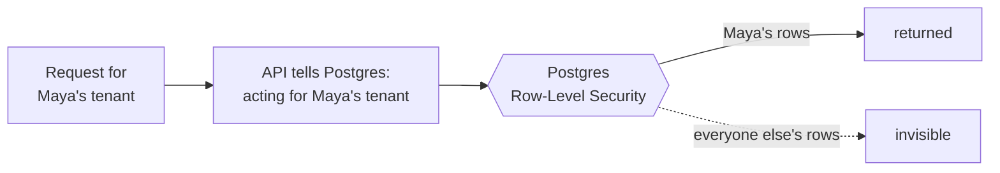
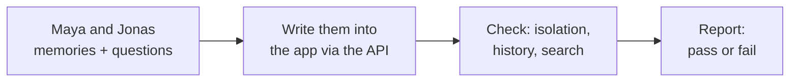

# Mutable

Memory for an AI assistant that knows when something it remembers has changed.

## The problem, in one example

Maya was vegetarian for nine years. In May 2025 she started eating fish.

An assistant booking her a dinner needs to know she's **pescatarian now**, and must never treat "vegetarian" as current. But "was Maya vegetarian in 2023?" still has a true answer: yes.

Most memory systems get one of these wrong. Either they overwrite the old answer and lose the history, or they keep both and can't tell which one is true today. Mutable keeps every version and always knows which one is current.

## How it works: three ideas

### 1. Memories keep every version

Nothing is overwritten. When a preference changes, the old version gets an end date and a link to the version that replaced it:

| Version | Content | Valid from | Valid to | Replaced by |
|---|---|---|---|---|
| v1 | Is vegetarian | 2016-01-01 | 2025-05-01 | v2 |
| v2 | Is pescatarian | 2025-05-01 | *(none, so current)* | |

"What does she eat now?" reads the version with no end date. "Was she vegetarian in 2023?" reads the version whose dates contain 2023. The old version ends exactly when the new one starts, so exactly one is true at any moment.

Memories come in three types, each with its own table:

- **Facts:** "lives in Lisbon"
- **Preferences:** "prefers tea over coffee". These are the ones that change and keep their history.
- **Episodes:** "adopted a cat in February 2025"

### 2. The database keeps each user's memories separate

Every user's memories live in their own private space, called a *tenant*. Postgres itself enforces the separation, using a feature called **Row-Level Security**. Each request tells the database which tenant it's acting for, and the database hides every row that belongs to anyone else.



The Python code never filters rows by user itself, so a forgotten filter can't leak anyone's data.

> **Not yet:** the API trusts whatever tenant id a request sends. Real accounts, so nobody can pose as someone else, are milestone 7.

### 3. Every change is graded

An **eval** tests Mutable on every pull request, like an exam with an answer key:

- Two fictional people, **Maya** (100 memories) and **Jonas** (28), are written into the app through its public API.
- **75 questions about Maya** each list the memories a correct answer must include, and the outdated ones it must not. For "What's Maya's diet these days?", "pescatarian" must be found and "vegetarian" must not be.
- The eval checks three things:
  - Jonas can never see Maya's memories, and Maya can never see his.
  - Preference history is stored correctly.
  - Search answers the questions well. This part starts in milestone 4.



20 more **held-out** questions are scored separately and never used to tune search. They catch a search that only works on the questions it was tuned against.

## Status

Milestones 1–3 are done. Milestone 4, search, is in progress.

| # | Milestone | What it means for the user | |
|---|---|---|---|
| 1 | Scaffold | The foundation: database, migrations, CI | ✅ |
| 2 | Storage | Memories are stored, versioned, and private to each user | ✅ |
| 3 | Eval | "Remembering correctly" is defined and checked on every change | ✅ |
| 4 | Search | The assistant can recall: ask a question, get the right memories | 🚧 |
| 5 | Caching | Recall feels instant | |
| 6 | Deploy | Mutable is reachable on the internet | |
| 7 | Accounts | Users sign up and get their own key; nobody can pose as them | |
| 8 | Free-text input | "I've gone pescatarian" becomes the right memory | |
| 9 | Answers | A direct answer that cites the memories it came from | |
| 10 | Client app | Usable by someone who isn't a developer | |
| 11 | Documents | Ask about whole documents, not just short statements | |
| 12 | Agent actions | The assistant acts on what it knows, with an audit trail | |

Every milestone in full, including how each one is checked: [docs/roadmap.md](docs/roadmap.md).

**Built with:** Python, FastAPI, PostgreSQL (with Row-Level Security and pgvector), SQLAlchemy, Alembic, Docker Compose, GitHub Actions.

## Getting started

```bash
cp .env.example .env
docker compose up -d db
docker compose run --rm api alembic upgrade head
docker compose up
```

Then:

```bash
curl localhost:8000/health        # the API is up
curl localhost:8000/health/db     # the API can reach Postgres

# Store a fact. Any UUID works as a tenant id; the tenant is created on first use.
curl -X POST localhost:8000/facts \
  -H "X-Tenant-Id: 3f9a1c2e-0000-4000-8000-000000000001" \
  -H "Content-Type: application/json" \
  -d '{"content": "Lives in Lisbon", "confidence": 0.9}'
```

| To | Run |
|---|---|
| Run the tests | `docker compose run --rm api pytest` |
| Lint | `docker compose run --rm api ruff check .` |
| Run the eval (API must be up) | `docker compose run --rm api python -m eval.run_eval --base-url http://api:8000` |

Interactive API docs are at `localhost:8000/docs` while the API runs.

## What's where

| Path | What's in it |
|---|---|
| `app/` | The API: the FastAPI app, the tables, the request and response shapes, one router per memory type |
| `migrations/` | The database's history, numbered `0001`–`0007` in the order they run |
| `eval/` | The eval: Maya's and Jonas's data files, and one Python module per step |
| `tests/` | Tests that run against a real Postgres, so the real isolation rules are what get tested |
| `docs/` | The detail behind this page |

## Learn more

- **[docs/architecture.md](docs/architecture.md):** what happens during a request, how isolation works, the data model, the stack and why each piece was chosen, and known gaps
- **[docs/eval.md](docs/eval.md):** how the eval works step by step, and what each score means
- **[docs/roadmap.md](docs/roadmap.md):** every milestone, what it ships, and how it's checked
- **[eval/personas.md](eval/personas.md):** who Maya and Jonas are, and why their data is shaped the way it is

## Glossary

| Term | Meaning |
|---|---|
| **Tenant** | One user's private space. Every row in the database belongs to exactly one tenant. |
| **Memory**, or **record** | One stored item: a fact, a preference or an episode. |
| **Supersede** | Replace a preference with a newer version. The old one is closed, not deleted, and points to its replacement. |
| **Valid from / valid to** | The dates a version was true. An empty "valid to" means it's still current. |
| **Row-Level Security (RLS)** | A Postgres feature that hides rows a query isn't allowed to see. Here it hides every other tenant's rows. |
| **Migration** | One numbered step in the database's history, such as "add the facts table". |
| **Eval** | The automated exam that grades Mutable on every pull request. |
| **Persona** | A fictional user in the eval: Maya or Jonas. |
| **Expected answers** | For each eval question, the memories a correct answer must include. |
| **Held-out questions** | Eval questions never used to tune search. They show whether tuning generalizes. |
| **Recall@5** | Of the memories a question expects, the share that appear in the top 5 results. |
| **MRR** | Mean reciprocal rank: how high the first right answer ranks. 1st place scores 1, 2nd scores ½, 3rd scores ⅓, and not found scores 0. |
