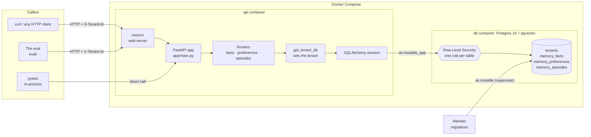
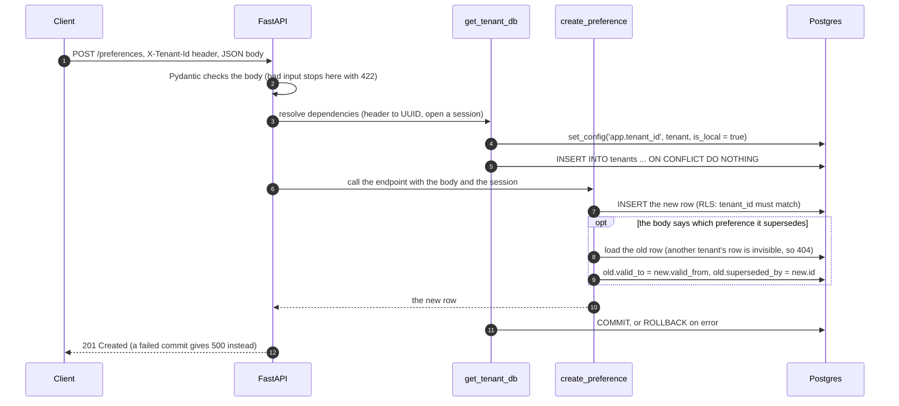
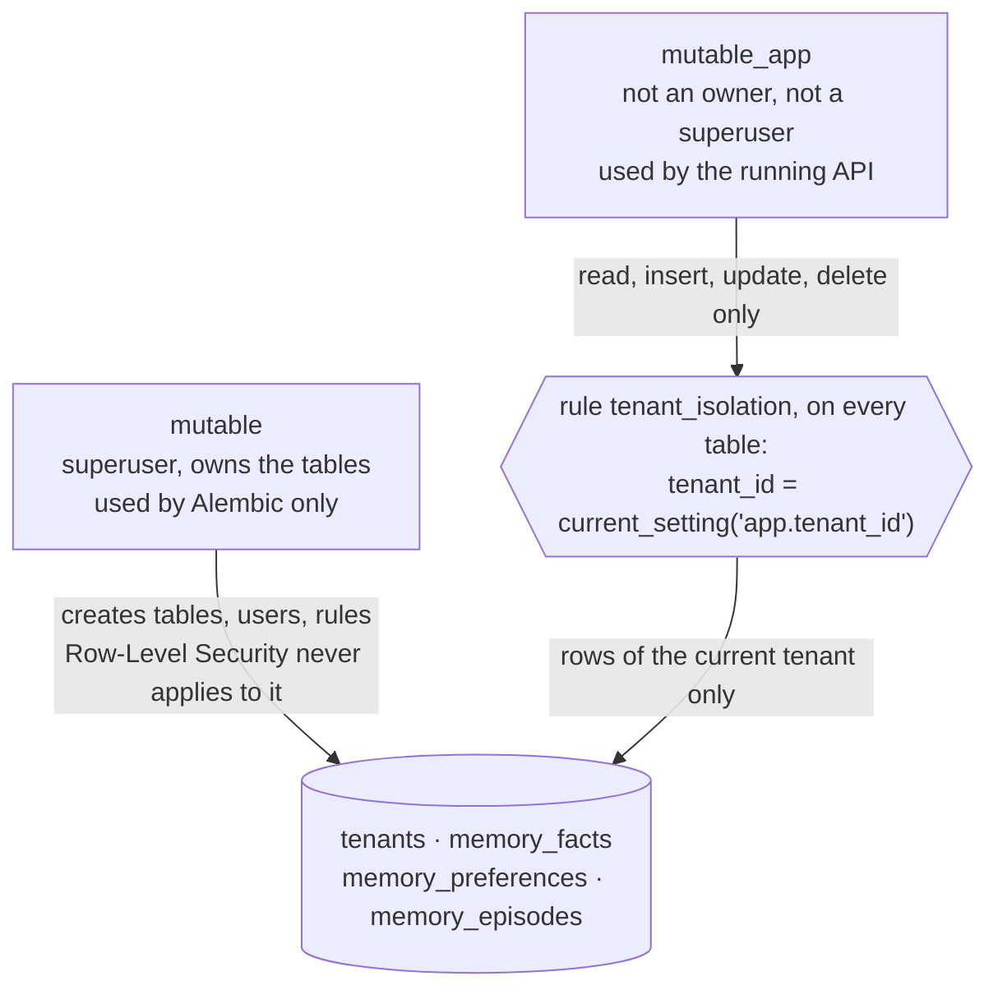
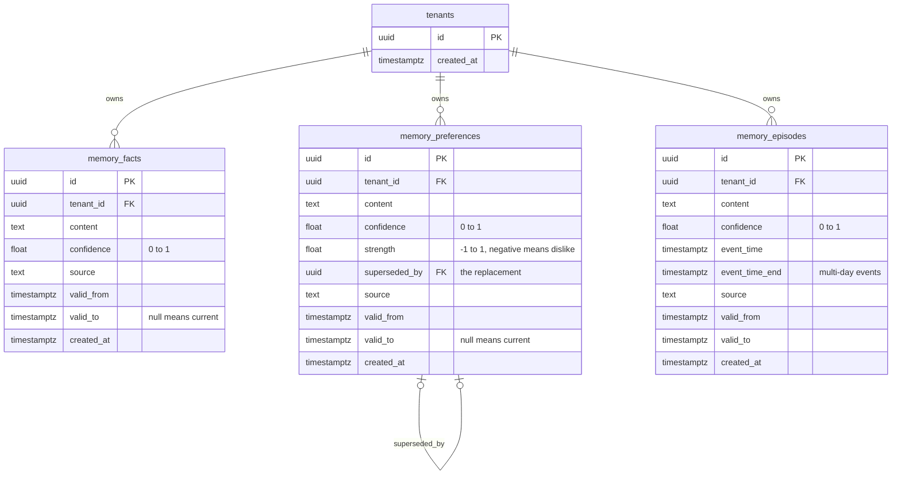
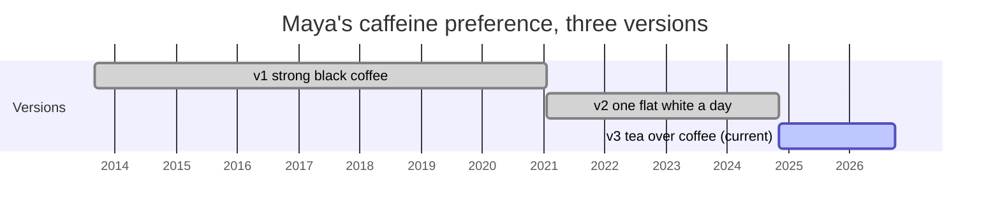
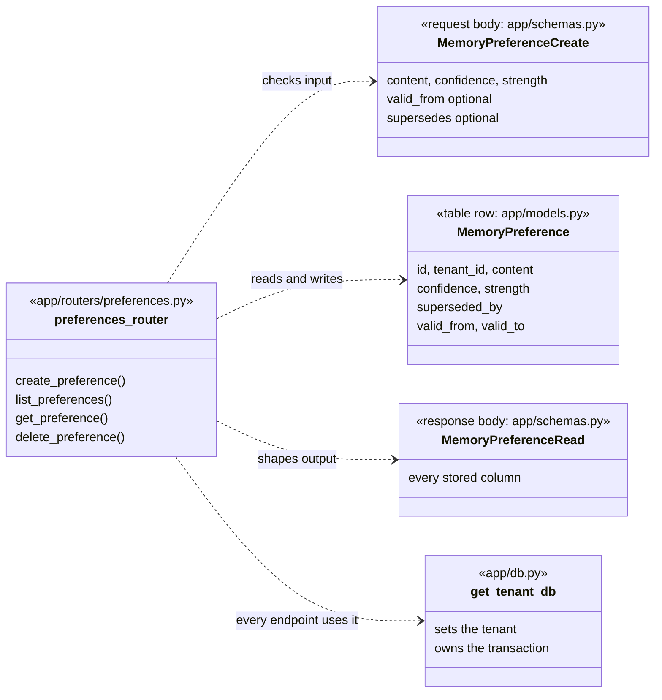

# Architecture

How Mutable works today, after milestones 1–3, and why it's built this way. Anything planned is marked with its milestone. Terms are defined in the [glossary](../README.md#glossary).

**In one paragraph:** Mutable is a FastAPI web service in front of a Postgres database. A caller sends JSON over HTTP, with an `X-Tenant-Id` header saying which tenant the request is for. Pydantic checks the JSON, and SQLAlchemy turns it into rows in one of three tables. Postgres itself, not the Python code, guarantees that one tenant can never see another's rows. A preference is never overwritten: a change closes the old row and links it to the new one, so the history can always be queried.

## The system at a glance

Two paths reach the database, deliberately with different rights:

- **The API** connects as `mutable_app`, a restricted database user that Row-Level Security always applies to.
- **Alembic** connects as `mutable`, the superuser, because it creates tables, users and security rules. It never serves a request.

## What happens during one request

Here is `POST /preferences` replacing an older preference, the most involved write in the system:

Three details make the tenant scoping hold:

- **`set_config(..., is_local = true)` sets the tenant for this transaction only.** Database connections are reused across requests. A setting that outlived the transaction would carry one request's tenant into the next.
- **A tenant is created the first time its id is used.** There's no sign-up step yet. This is safe because the `tenants` table has a Row-Level Security rule too: a caller can only ever create a tenant with its own id.
- **Each request is one transaction, committed at the end but before the response is sent.** That ordering means a commit that fails can never be reported to the caller as a success. `TENANT_DB` in [app/db.py](../app/db.py) does this with FastAPI's `scope="function"`.

## Isolation: two database users and one rule

The rule applies in both directions:

- **Reading:** a query only sees rows of the current tenant (the `USING` clause).
- **Writing:** an insert or update can only create rows for the current tenant (the `WITH CHECK` clause).

If no tenant was set, the rule raises an error instead of quietly matching nothing. It's created in [0007_enable_row_level_security.py](../migrations/versions/0007_enable_row_level_security.py).

| How to isolate tenants | How it works | Why not chosen |
|---|---|---|
| **Postgres Row-Level Security** ✅ | The database filters every row by the transaction's tenant | Chosen. The cost: every transaction must set the tenant, which `get_tenant_db` does |
| `WHERE tenant_id = ...` in Python | Every query remembers to filter | One forgotten filter is a silent data leak |
| A schema per tenant | Each tenant gets its own copy of the tables | Every migration runs once per tenant; anything across tenants gets awkward |
| A database per tenant | The strongest separation | Heavy to run for many small tenants |

It's tested twice:

- [tests/test_isolation.py](../tests/test_isolation.py) connects to Postgres directly, as the API's user, and shows each tenant sees only its own rows.
- [The eval](eval.md) tries to reach every one of Maya's and Jonas's records as the other person, on every pull request.

## The data model

**How a preference changes.** Nothing is overwritten. The old row is closed exactly where the new one starts, so at any moment exactly one version is valid. Here is Maya's caffeine preference from the eval data, which has changed twice:

- "What does she drink now?" reads the row with `valid_to = null`.
- "What did she drink in 2022?" reads the row whose window contains 2022.
- A caller may backdate `valid_from` to record real history. A replacement dated before the row it replaces is rejected.

| Decision | Chosen | Alternative | Trade-off accepted |
|---|---|---|---|
| Table layout | Three typed tables | One table with a JSON payload | A little repetition across tables, in exchange for real columns and constraints per type |
| Change history | `valid_from` / `valid_to` + `superseded_by` | Overwrite in place; a separate audit-log table | "Current" queries must filter `valid_to IS NULL` |
| Which types keep versions | Preferences only | Facts too | A changed fact is written in the past tense ("worked at Studio Loop, 2019–2024") until facts can be superseded |
| Confidence | Supplied by the caller | Worked out by the system | Nothing to work it out from until free-text input (milestone 8) |
| Input format | Structured JSON only | Free text, turned into records by an LLM | Writes stay predictable and easy to audit; free text is milestone 8 |

**Why only three types.** There's no documents type, because long text needs splitting into chunks, a different search problem (milestone 11). There's no "rules" type for things like "always ask before booking", because rules are about how an agent behaves, not something it looks up; one could be stored as a preference if ever needed.

## How the API code is organized

Every memory type has the same four parts. Preferences are shown here; facts and episodes follow the same pattern.

- **A table row and the request and response bodies are separate classes on purpose.** The SQLAlchemy model is what a row *is*. The Pydantic schemas are what a caller may *send* and will *get back*. A caller can't send an `id` or `tenant_id`, and `supersedes` is an instruction, not a column.
- **The three routers repeat the same shape deliberately.** One generic router could replace them and save about 100 lines, but each endpoint would get harder to read and to change on its own. That's worth avoiding while the types still differ in their details: episodes check event times, and preferences supersede.

## The stack, and why

| Tool | Its job here | Why this one | Not chosen, and why |
|---|---|---|---|
| **FastAPI** | Routing, request checking, attaching the tenant to every request (`Depends`), API docs at `/docs` | Checks requests from type hints; `Depends` makes tenant scoping one line per endpoint | **Flask:** no built-in request checking. **Django:** more than an API-only service needs |
| **Pydantic** | Request and response shapes, settings from environment variables, checking the eval's YAML | One way to say "this data must look like this", with clear errors | Hand-written checks. **SQLModel** would merge request shapes and tables, but here they differ on purpose |
| **SQLAlchemy 2.0** | Python classes for tables, sessions, transactions | Typed models; Alembic reads them to generate migrations | Hand-written SQL for every query |
| **PostgreSQL 16** | Storage, constraints, **Row-Level Security** | Isolation becomes a database guarantee | A separate vector database (Pinecone, Qdrant) would need its own, second isolation mechanism |
| **pgvector** | Vector search inside Postgres (enabled, used from milestone 4) | Embeddings live in the same rows, under the same isolation rule | See above |
| **Alembic** | Numbered migrations in [migrations/versions/](../migrations/versions/) | Creates tables *and* what an ORM can't: database users and security rules | Creating tables from the models: no history, no upgrades, no users or rules |
| **Docker Compose** | Two containers: `db` (Postgres + pgvector) and `api` (with live reload) | The same database for everyone, one command to start; milestone 6 deploys this same file | Local installs that drift between machines |
| **pytest** | Tests that call the app in-process against the **real** Postgres | The real isolation rules and constraints get tested | SQLite or mocks would be faster, but have no Row-Level Security; they'd test a different system |
| **Ruff** | Lint and formatting | One fast tool | flake8 + isort + black separately |
| **GitHub Actions** | Lint, tests and the eval on every pull request | Lives next to the code; free at this scale | Any CI would do |

## Planned: search and routing (milestone 4)

Not built yet. This is the design milestone 4 is working toward:

- **`/search`** takes a plain-language question and returns ranked records. It returns records, not prose; turning them into an answer is milestone 9.
- **Embeddings are computed when a record is written**, and stored in the same row.
- **Search is hybrid:** vector similarity for meaning, plus full-text search for exact words like names, merged by rank. It always runs inside the tenant's Row-Level Security boundary.
- **A rule-based router reads the question first.** It picks the record types to search, and the time scope:
  - current, the default
  - as of a date: "back in 2023"
  - full history: "used to"

  Out-of-date versions are filtered out by date, not just ranked lower.
- **An LLM-based router is a possible version 2.** It's deferred because it adds latency, cost and unpredictability to every query. The eval can compare the two later.

See [milestone 4 in the roadmap](roadmap.md#4-search) for the steps and how it's checked.

## Known gaps

- **No authentication yet.** The API trusts whatever `X-Tenant-Id` it's given, so anyone who knows or guesses a tenant id can act as that tenant. Row-Level Security guarantees tenants can't see *each other*, not that a caller is who they claim to be. Real accounts are milestone 7.
- **Deletes are permanent,** which sits awkwardly with "never lose history". Deleting a preference that an older version points to is refused (`409`), so a history chain can't break, but there's no undo.
- **Facts can't be superseded.** Only preferences keep versions; see the data model above.
- **No search yet.** pgvector is installed but unused; search is milestone 4.
- **Endpoints are synchronous.** FastAPI runs them in a thread pool. That's simple and fine at this scale; async database access is an option if load ever demands it.
