# Mutable: Design Overview

> Memory for an AI assistant that knows when something it remembers has changed.

**In 30 seconds.** An assistant's memory has to change as the person changes. Maya was vegetarian for nine years; in May 2025 she became pescatarian. Ask "what does she eat?" and the answer must be *pescatarian*, never the outdated *vegetarian*. Ask "was she vegetarian in 2023?" and the answer must still be *yes*.

Mutable does four things to make that work:

- It stores every version of a memory.
- It knows which version is true now.
- It walls off each user's memories inside the database itself.
- It grades itself against a fixed exam on every change.

**Status, October 2026.** Storage, isolation and the eval are built and tested (milestones 1–3). Search, the part that recalls memories, is being built now (milestone 4).

| Section | |
|---|---|
| [1. Architecture](#1-architecture) | How it works, and why it's built this way |
| [2. Roadmap](#2-roadmap) | What's done, what's next, and how each step is checked |
| [3. Evaluation](#3-evaluation) | How we prove it remembers correctly |
| [4. Gaps and open problems](#4-gaps-and-open-problems) | What doesn't work yet, and the plan for each |
| [5. Code reference](#5-code-reference) | Every file, class and framework, for engineers working on the code |

---

## 1. Architecture

### 1.1 The system at a glance

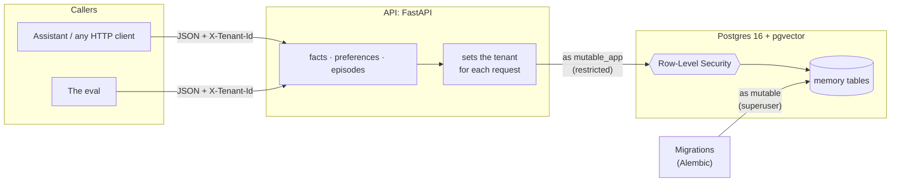

Mutable is a web API in front of a Postgres database:

- **Every request names its tenant.** The `X-Tenant-Id` header says whose memory the request is about; each user's private space is called a *tenant*.
- **The API connects as a restricted database user.** Row-Level Security always applies to `mutable_app`.
- **Only migrations use the superuser.** `mutable` creates tables, users and security rules, and never serves a request.

### 1.2 Memories: three types, versions instead of overwrites

| Type | Example | Can it change? |
|---|---|---|
| **Fact** | "Lives in Lisbon" | Not yet (see [gap 4.5](#45-facts-cant-change-yet)) |
| **Preference** | "Prefers tea over coffee" | Yes. A new version supersedes the old one, and the old one is kept. |
| **Episode** | "Adopted a cat in February 2025" | No. It's an event that happened. |

Each type has its own table. All three share the same core columns:

- `id`
- `tenant_id`
- `content`
- `confidence` (0–1)
- `source`
- `valid_from` and `valid_to` (an empty `valid_to` means current)
- `created_at`

Preferences add `strength`, from −1 (dislike) to +1 (like), and `superseded_by`. Episodes add `event_time` and `event_time_end`.

**How a change is stored.** Nothing is overwritten. The old version is closed exactly when the new one starts, and points to its replacement:

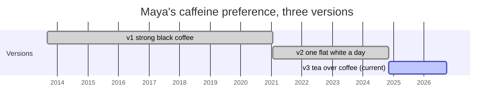

- **"What does she drink now?"** reads the version with no end date.
- **"What did she drink in 2022?"** reads the version whose dates contain 2022.
- **History can be backdated.** A caller may set `valid_from` in the past to record real history.
- **A replacement can't predate what it replaces,** and a version that's already closed can't be replaced again. So each chain has exactly one current version.

### 1.3 Isolation: the database keeps users apart

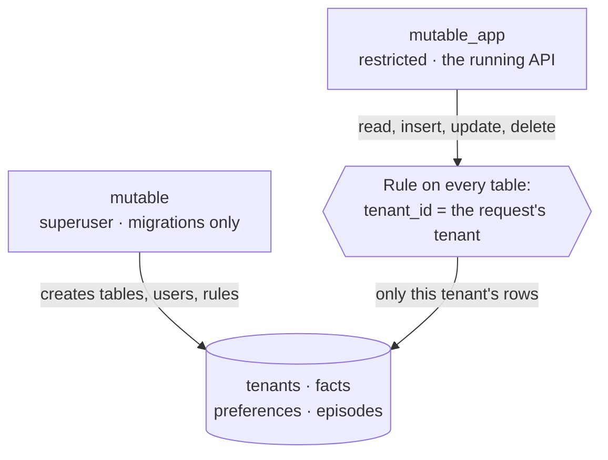

- **Each request tells Postgres which tenant it's acting for,** at the start of its transaction.
- **A Postgres rule on every table hides all other tenants' rows,** for reading and for writing. The Python code never filters by user, so a forgotten filter can't leak data.
- **If no tenant is set, the rule raises an error** instead of quietly matching nothing.
- **It's tested twice.** A test queries Postgres directly as the API's user. The eval also tries to reach every one of Maya's records as Jonas, and every one of his as her, on every pull request.

### 1.4 One request, step by step

Replacing a preference is the most involved write:

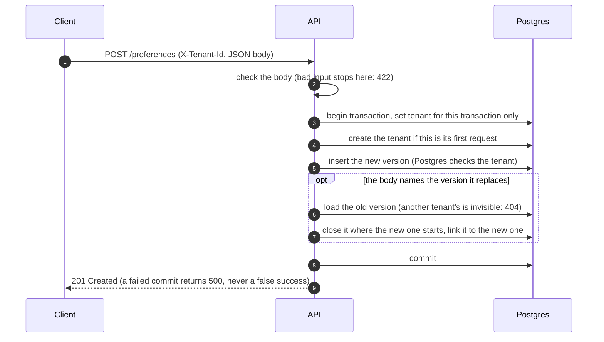

Three details make this safe:

- **The tenant setting dies with the transaction.** Database connections are reused across requests, so a setting that outlived its transaction could leak one request's tenant into the next.
- **Tenants are created on first use, with no sign-up.** That's safe from other tenants, because the tenants table has the same rule: a caller can only create its own tenant. It doesn't prove who the caller is; see [gap 4.7](#47-no-authentication-yet-and-the-roadmap-deploys-first).
- **The commit happens before the response is sent.** A failure can never be reported as a success.

### 1.5 Key decisions

| Decision | Chosen | Instead of | Why |
|---|---|---|---|
| Isolating users | Postgres Row-Level Security | `WHERE tenant_id = …` in code; a schema or database per user | One forgotten filter leaks data. Per-user schemas multiply every migration. |
| Where vectors live | pgvector, inside Postgres | A separate vector database | One isolation mechanism instead of two |
| Embedding model | A small local model (`BAAI/bge-small-en-v1.5`, run by fastembed) | An embeddings API | No API key, no cost per call, and memories never leave the server to be embedded |
| Table layout | Three typed tables | One table with a JSON payload | Real columns and constraints for each type |
| History | `valid_from` / `valid_to` + `superseded_by` | Overwriting; a separate audit log | "What did she use to…" is an ordinary query |
| Input | Structured JSON only, for now | Free text read by an LLM | Writes stay predictable and auditable. Free text is milestone 8 (see [gap 4.2](#42-updating-memory-reliably-and-the-llm-problem)) |
| Search routing (planned) | Rules first | An LLM router | Fast, free and predictable. The eval can compare the two later. |

### 1.6 The stack

| Tool | Role |
|---|---|
| **FastAPI + Pydantic** | The HTTP API. Requests are checked against typed schemas, and the tenant is attached to every request. |
| **PostgreSQL 16** | Storage, constraints, Row-Level Security |
| **pgvector** | Vector search inside Postgres, used from milestone 4 |
| **fastembed** | Runs the embedding model on the API's own CPU, for search (milestone 4) |
| **SQLAlchemy + Alembic** | Tables as Python classes; numbered migrations `0001`–`0007` |
| **Docker Compose** | The same database and API for every developer; milestone 6 deploys this same setup |
| **pytest** | Tests run against a real Postgres, so the real isolation rules get tested |
| **GitHub Actions** | Lint, tests and the full eval on every pull request |

---

## 2. Roadmap

Each milestone ships something that runs and can be checked on its own.

| # | Milestone | What the user gets | Done when | |
|---|---|---|---|---|
| 1 | Scaffold | The foundation | Postgres, migrations and CI run | ✅ |
| 2 | Storage | Memories stored, versioned, private to each user | One tenant provably can't read another's rows, even querying Postgres directly | ✅ |
| 3 | Eval | "Remembering correctly" defined and checked on every change | The eval runs on every pull request: 0 leaks, correct history | ✅ |
| 4 | **Search** | **Ask a question, get the right memories** | **Recall@5 ≥ 0.9 and MRR ≥ 0.8, including held-out questions** | 🚧 |
| 5 | Caching | Recall feels instant | Faster in p95 latency, with identical eval scores | |
| 6 | Deploy | Reachable on the internet | A live endpoint; a pull request that breaks isolation can't merge | |
| 7 | Accounts | Users sign up and get their own key | A real login flow issues keys that the same isolation rule enforces | |
| 8 | Free-text input | "I've gone pescatarian" becomes the right memory | Plain text produces the same records a structured request would, reviewable before saving | |
| 9 | Answers | A direct answer, citing its sources | Every answer cites the ids of the memories it used | |
| 10 | Client app | Usable by people who aren't developers | Someone else can add and look up memories without curl | |
| 11 | Documents | Ask about whole documents | The right passage is returned, checked against its own questions | |
| 12 | Agent actions | The assistant acts on what it knows | A real action, with an audit trail back to the memory behind it | |

### 2.1 Now: milestone 4, search

**Goal.** Before the assistant answers or acts ("book me dinner on Friday"), it asks its memory a plain question ("what should I know about Maya's food?"). It should get back the right records (pescatarian, shellfish allergy, dislikes cilantro) and never the outdated "vegetarian".

**Design.**

- `/search` returns ranked records, not prose; prose answers are milestone 9.
- Each record's meaning is turned into a vector when it's written.
- Search combines vector similarity, for meaning, with full-text search, for exact words like names.
- A rule-based router decides which record types to search, and the time scope:
  - **now**, the default
  - **as of a date:** "back in 2023"
  - **full history:** "used to"
- Out-of-date versions are filtered out by date, not just ranked lower.

**Built in ten small steps,** one pull request each:

| # | Step | |
|---|---|---|
| 1 | Held-out questions: 20 more, never used for tuning | ✅ |
| 2 | Embedding model behind one interface, plus a predictable fake for tests | ✅ |
| 3 | Store each record's vector and full-text index when it's written | |
| 4 | `/search` v1: vector search over current records. The eval calls it, giving the first real scores | |
| 5 | Hybrid search: add full-text, merge both rankings | |
| 6 | Router, time scope: now, as of a date, or full history | |
| 7 | Router, record types: which tables to search | |
| 8 | Episode dates: "in October 2025", "most recent" | |
| 9 | Reach the score targets; check the held-out score once, at the end | |
| 10 | Make CI fail any pull request that misses the targets | |

---

## 3. Evaluation

### 3.1 Why

You can't tell whether search is good by trying a few questions by hand. Every change to search can quietly break questions nobody tried. And Mutable's main promise is easy to get wrong: a search that matches on words will happily return "Is vegetarian", because it mentions diet just as much as "Is pescatarian" does.

So the eval is **an exam with an answer key, run on every pull request.** It was written in milestone 3, before any search code, so the definition of "good" was fixed before anything could be tuned to pass it.

### 3.2 The test data

Both people are fictional, so there's no real personal data in the repo.

- **Maya** has 100 records: facts, preferences that change over time (diet, caffeine, travel style…), and a dated timeline of events. All the questions are about her.
- **Jonas** has 28 records and exists only to catch leaks. His details differ from Maya's but cover the same topics (city, job, allergies, coffee), so a leaked record would actually rank in her results, and be caught.

### 3.3 Questions and their expected answers

Each question lists the records a correct answer must include, and sometimes the outdated ones it must not:

```yaml
- id: q001
  question: What's Maya's diet these days?
  expected: [maya.pref.diet.v2]        # "Is pescatarian": must be in the top 5
  must_exclude: [maya.pref.diet.v1]    # "Is vegetarian": must not appear at all
```

| Category | Questions | What it checks |
|---|---|---|
| Changed preference, now | 10 | The current version is found, and every older version is excluded |
| Changed preference, in the past | 10 | An older version is still found; 7 of these pin a date |
| Facts | 24 | Plain lookups, some needing two records |
| Stable preferences | 13 | Including near-duplicates that are easy to confuse |
| Episodes | 12 | Dates, "most recent", several answers |
| Across types | 6 | "Why" questions linking a change to the event that caused it |

**20 held-out questions** follow the same rules but are never used to tune search. The eval reports only their total score, never question by question. If search does well on the 75 and poorly on these 20, it was tuned to the questions rather than getting better in general.

### 3.4 What's checked

| Check | What it proves | Today |
|---|---|---|
| **Isolation** *(must pass)* | Every one of Maya's records, requested as Jonas, returns "not found", and the reverse. No foreign record ever appears in a list or a search result. | ✅ 0 leaks |
| **History** *(must pass)* | Each old version links to its replacement and ends exactly when it starts, and only the newest version is current | ✅ 0 failures |
| **Recall@5** | The share of expected records found in the top 5 results | 0.00 (no search yet) |
| **MRR** | How high the first right answer ranks: 1st = 1, 2nd = ½, 3rd = ⅓ | 0.00 (no search yet) |
| **Excluded hits** | Outdated records returned. Each one fails its question, even if the right record was found too. | — |

**The target for milestone 4:** Recall@5 ≥ 0.9 and MRR ≥ 0.8, on both the 75 questions and the 20 held-out.

### 3.5 One run

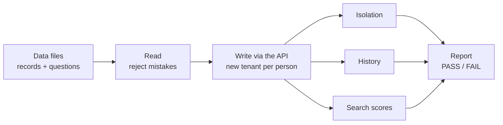

- **Records go in through the public API,** not straight into the database. The eval exercises the same checks, history logic and isolation that a real caller hits.
- **Search receives only the question text,** never the expected answers.
- **Each run uses brand-new tenants,** so runs can't interfere with each other.

---

## 4. Gaps and open problems

Mutable today stores, versions and isolates memories correctly, and proves it on every change. This section is what it does **not** do yet, or does in a way we know is fragile.

| # | Gap | Impact | Plan | When |
|---|---|---|---|---|
| [4.1](#41-two-preferences-true-at-the-same-time) | Two preferences true at the same time | High | Topics, explicit add-or-replace, context | Before milestone 8 |
| [4.2](#42-updating-memory-reliably-and-the-llm-problem) | Updating memory reliably with an LLM | High | The LLM proposes, code verifies, risky changes are confirmed | Milestone 8 |
| [4.3](#43-whose-memory-is-it) | Whose memory is it? | Medium | A subject on every memory | Before milestone 8 |
| [4.4](#44-mistakes-and-forgetting) | Mistakes vs changes, and forgetting | Medium | Retract and erase operations | Before milestone 8 |
| [4.5](#45-facts-cant-change-yet) | Facts can't change yet | Medium | Versions for facts too | Before milestone 8 |
| [4.6](#46-memories-go-stale-silently) | Memories go stale silently | Medium | "Last confirmed" date; re-ask | Milestone 9+ |
| [4.7](#47-no-authentication-yet-and-the-roadmap-deploys-first) | No authentication, and the roadmap deploys first | Critical before launch | Accounts before deploying | Milestones 6–7 |
| [4.8](#48-sensitive-data) | Sensitive data | High before launch | Encryption, LLM data terms, read audit | Milestones 6–8 |
| [4.9](#49-search-is-not-built-yet) | Search is not built yet | High | Milestone 4, in progress | Milestone 4 |
| [4.10](#410-the-eval-is-small-and-synthetic) | The eval is small and synthetic | Medium | More personas, independent questions, an extraction eval | Milestones 4–8 |
| [4.11](#411-operations-and-scale) | Operations and scale | Low today | Backups, monitoring, pinned dependencies, real secrets | Milestones 5–6 |

### 4.1 Two preferences true at the same time

**The case.** Maya "prefers coffee" and "prefers tea". There are three possibilities:

- Both are true: coffee in the morning, tea in the evening.
- The second replaced the first: she switched.
- One is about someone else: Sam, her partner, prefers coffee.

**Today:**

- **Both are stored as separate current preferences.** Nothing stops two current preferences on the same topic.
- **Only the caller decides whether the new one replaces the old,** by naming it (`supersedes: <id>`). If the caller doesn't, both stay current, even if they contradict each other.
- **Mutable doesn't know the two are about the same topic.** The topic exists only in the free text.
- **Conditions like "in the morning" aren't modeled.** They can only be written into the text, so search can't pick the version that applies right now.
- **The eval doesn't test this.** Every change in Maya's data is an explicit, linked replacement, and her other preferences never conflict.

**Plan:**

1. **A topic on every preference,** for example `drink.caffeine`, so "same subject" is data, not guesswork.
2. **Every write declares its intent:** *add* (both stay true) or *replace*. If a topic already has a current preference, a write that doesn't say which is rejected, not guessed.
3. **An optional context,** such as "mornings" or "at work", so coexisting preferences say when each applies.
4. **Likely contradictions are flagged for confirmation:** same topic, opposite strength, no declared intent. They're never silently kept side by side.
5. **Eval questions for coexisting and conditional preferences,** such as "What should I make Maya at 9 pm?".

### 4.2 Updating memory reliably, and the LLM problem

**Today, no LLM writes to memory.** The caller sends structured JSON and names exactly which record it replaces. Writes are predictable and auditable, but only because someone else has already done the hard part correctly.

**Milestone 8 changes that.** Users will just talk ("I've gone pescatarian"), and an LLM will turn that into records. This is where reliability gets hard:

| Risk | Example |
|---|---|
| **Invented memory** | "Had sushi once" becomes "loves sushi" |
| **Wrong target** | "Sam prefers coffee" replaces *Maya's* tea preference |
| **Misread meaning** | Negation ("I'm *not* vegan"), hypotheticals ("if I were vegan…"), temporary states ("off coffee this week") |
| **Inconsistency** | The same sentence produces different records on different runs. LLMs are not deterministic. |
| **Silent damage** | A wrong replacement closes a correct memory, and the assistant now treats something false as current |

**Design principle: the LLM proposes; deterministic code decides.** The LLM never writes to the database.

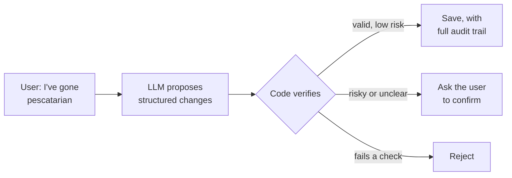

| # | Safeguard | What it prevents |
|---|---|---|
| 1 | **A fixed schema.** The LLM can only fill in: action (add / replace / ignore), type, topic, subject, content, and the record being replaced. Anything else is rejected. | Free-form writes |
| 2 | **Every proposal quotes its evidence.** It includes the exact words from the user's message, and code checks that quote appears in the message. No quote, no write. | Invented memories |
| 3 | **The LLM picks targets; it can't invent them.** Code looks up the current records on that topic and offers their ids as a short list. The LLM picks one or none. Code then checks the target exists, is current, belongs to this user, and has the same type. | Wrong or made-up targets |
| 4 | **Risky changes need confirmation.** Replacements, low-confidence proposals, and anything sensitive (health, allergies) are confirmed with the user first: "Did you stop being vegetarian?" | Silent damage |
| 5 | **Everything is reversible.** A replacement never deletes the old version, so undo is cheap: reopen the old one, close the new one. Every write records its source message, model and prompt version. | Unrecoverable mistakes |
| 6 | **Non-determinism is made harmless.** Temperature 0 and a pinned model version reduce variation but don't remove it. So a repeated request never writes twice, a proposal identical to an existing memory is a no-op, and consistency is measured rather than assumed. | Duplicates and drift |
| 7 | **An extraction eval.** Messages with their expected changes, including traps (negation, other people, hypotheticals, temporary states), run several times. It scores wrong writes first, because a missed memory is better than a false one, and also checks agreement between runs. | Regressions going unnoticed |

None of this is built yet. Today's writes are reliable precisely because no LLM is involved.

### 4.3 Whose memory is it?

**Everything in a tenant is assumed to be about the user.** Facts about other people are stored as text ("Sam, her partner, is a photographer"). Nothing distinguishes "Sam prefers coffee" from "Maya prefers coffee", so search, and later the LLM, can confuse them.

**Plan:** a **subject** on every memory: the user, or a named person. It's required before free-text input (4.2), because mixing up who something is about is one of the most likely extraction errors.

### 4.4 Mistakes and forgetting

**A correction is not a change.** "She moved in 2023, not 2024" means the old record was *never* true. Today there are only two tools, and both are wrong for this:

- **Replacing** the record would preserve the mistake as history.
- **Deleting** it is permanent. And for a preference that replaced another, deleting is refused, so its chain doesn't break.

**Forgetting is a requirement too.** Users must be able to make Mutable forget, for privacy law and for trust. Today, erasing a changed preference means deleting its versions oldest-first.

**Plan:** two explicit operations.

- **Retract:** the record is marked wrong. It's hidden from all answers but kept for audit.
- **Erase:** the record is removed permanently, with every version, its vector and any cached copy.

### 4.5 Facts can't change yet

Only preferences have versions. If Maya moves, "Lives in Lisbon" can't be replaced; today it has to be deleted, or written in the past tense ("lived in Toronto until 2024"). Facts already have the date columns.

**Plan:** use the same supersede mechanism for facts. It's a small change.

### 4.6 Memories go stale silently

A preference stated in 2019 and never updated is treated as current today, with full confidence. There's no "last confirmed" date, and confidence never decays.

**Plan:** record when each memory was last confirmed, weigh older ones lower in search, and have the assistant re-check old, important memories.

### 4.7 No authentication yet, and the roadmap deploys first

**The API trusts any `X-Tenant-Id`.** Isolation stops tenants seeing each other; it doesn't stop someone from claiming to be a tenant. Tenant ids are long random UUIDs, hard to guess, but they're identifiers, not secrets.

**The roadmap puts deploying (milestone 6) before accounts (milestone 7).**

> **Recommendation:** build accounts before deploying, or keep the deployed API private (reachable only from known addresses) until milestone 7.

### 4.8 Sensitive data

Memories include health details (allergies), relationships and locations. Isolation between users is strong. The rest isn't built yet:

- encryption beyond the disk's own
- a log of who read what
- a retention policy

**Milestones 8 and 9 would send personal text to an LLM provider.** That needs a provider that doesn't train on the data or keep it, and only the minimum text should be sent. Search doesn't: its embedding model runs on the server itself.

### 4.9 Search is not built yet

**The core value is unproven.** Recall is what users actually experience, and today it scores 0 because it doesn't exist. The targets (Recall@5 ≥ 0.9, MRR ≥ 0.8) are goals, not results.

**Known weak spots, even after milestone 4:**

- **Implicit time is out of reach for rules.** For "What was her coffee habit *when she was at university*?", rules can't turn the phrase into a date, so old and new versions both come back. 2 of the 75 questions are like this. An LLM router is the likely fix.
- **Approximate vector indexes and Row-Level Security interact at scale.** Together they can return fewer results than asked for, because the security filter runs after the approximate search has narrowed the candidates. That's fine at today's size, but it must be designed for before there are many users.

### 4.10 The eval is small and synthetic

- **It's narrow.** It's one rich persona with 75 + 20 questions, in English, hand-written by the people building search. Real users phrase things differently.
- **The held-out questions were written by the same author.** They limit overfitting, but they'd be stronger written by someone independent.
- **Some things aren't measured yet:**
  - extraction quality (4.2)
  - coexisting preferences (4.1)
  - latency (from milestone 5)
  - cost

**Plan:**

- more personas, with questions written by someone outside the team
- real phrasing from consenting users, anonymized, once available
- an extraction eval as part of milestone 8

### 4.11 Operations and scale

- **No backups, monitoring or load testing yet.** Endpoints are synchronous, on a single Postgres. That's fine for development.
- **Dependencies set minimum versions only (`>=`), with no lock file.** Two builds a month apart can install different versions. Pinning them makes builds reproducible.
- **Development passwords are committed to the repo,** in `docker-compose.yml`, `.env.example` and the migration that creates the API's database user. That's fine locally. Production needs real secrets, and the API user's password must not come from a migration.

All of this is milestones 5–6.

### Proposed roadmap changes

These follow from the gaps above:

1. **Accounts before deploy** (4.7): swap milestones 6 and 7, or deploy privately.
2. **Before free-text input (milestone 8)**, add to the data model:
   - topic and add-or-replace intent (4.1)
   - subject (4.3)
   - retract and erase (4.4)
   - versions for facts (4.5)
3. **Milestone 8 is done only when** the extraction eval (4.2) passes, with zero wrong writes on its trap cases.

---

## 5. Code reference

Every file, class and framework, for engineers working on the code. Sections 1–4 are the overview; this is the detail behind it.

### 5.1 Repository layout

```
mutable/
├── app/                          the API
│   ├── main.py                   creates the FastAPI app; /health, /health/db, /whoami
│   ├── config.py                 Settings: the two database URLs
│   ├── db.py                     engine, sessions, tenant scoping (TENANT_DB)
│   ├── models.py                 SQLAlchemy table classes
│   ├── schemas.py                Pydantic request and response classes
│   ├── embeddings.py             turns text into vectors: the real model, and a fake for tests
│   └── routers/
│       ├── facts.py              /facts
│       ├── preferences.py        /preferences, including supersede
│       └── episodes.py           /episodes
├── migrations/
│   ├── env.py                    Alembic setup; connects as the superuser
│   ├── script.py.mako            template for new migrations
│   └── versions/0001 … 0007      the schema history, in run order
├── eval/
│   ├── data/maya/                records.yaml · questions.yaml · heldout.yaml
│   ├── data/jonas/               records.yaml
│   ├── personas.md               who Maya and Jonas are
│   ├── read_data.py              step 1: read and validate the files
│   ├── write_data.py             step 2: write them into the app
│   ├── check_isolation.py        step 3a: isolation check
│   ├── check_supersede.py        step 3b: history check
│   ├── score_retrieval.py        step 3c: search scoring
│   ├── report.py                 step 4: totals, pass/fail, the printed table
│   └── run_eval.py               runs steps 1–4; the command-line entry point
├── tests/
│   ├── conftest.py               shared fixtures: client, tenant, other_tenant
│   └── test_*.py                 API, isolation, transaction, embedding and eval tests
├── docs/design.md                this document
├── Dockerfile · docker-compose.yml
├── alembic.ini · pyproject.toml · requirements.txt · requirements-dev.txt · .env.example
└── .github/workflows/ci.yml
```

`app/`, `app/routers/`, `eval/` and `tests/` each also have an empty `__init__.py`, which makes them importable Python packages.

### 5.2 Frameworks and libraries

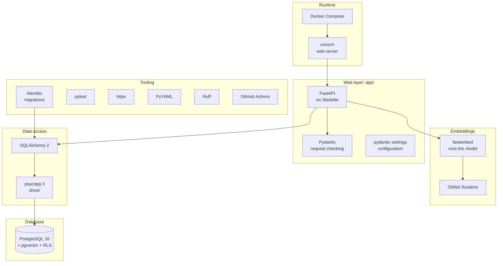

| Library | Tested with | Required | Used in | What it does here |
|---|---|---|---|---|
| **FastAPI** | 0.143 | ≥ 0.115 | `app/` | Routing, request parsing, dependencies (`Depends`), API docs at `/docs` |
| **Starlette** | 1.8 | via FastAPI | `app/`, `tests/` | The web toolkit under FastAPI; its `TestClient` drives the tests |
| **uvicorn** | 0.54 | ≥ 0.32 | Dockerfile, CI | The web server that runs the app |
| **Pydantic** | 2.14 | via FastAPI | `app/schemas.py`, `eval/read_data.py` | Data checking from type hints |
| **pydantic-settings** | 2.16 | ≥ 2.5 | `app/config.py` | Settings from environment variables or `.env` |
| **SQLAlchemy** | 2.1 | ≥ 2.0 | `app/`, `migrations/`, `tests/` | Table classes, sessions, transactions |
| **psycopg** | 3.3 | ≥ 3.2 | via SQLAlchemy | The Postgres driver (`postgresql+psycopg://` URLs) |
| **Alembic** | 1.20 | ≥ 1.13 | `migrations/` | Numbered schema migrations |
| **pgvector** (Python) | 0.5 | ≥ 0.3 | not imported yet | Vector column types for SQLAlchemy; used from milestone 4 |
| **fastembed** | 0.9 | ≥ 0.9 | `app/embeddings.py`, Dockerfile, CI | Downloads the embedding model once, then runs it on the CPU (through ONNX Runtime) |
| **httpx** | 0.28 | ≥ 0.27, dev | `eval/`, `tests/` | HTTP client; same interface as `TestClient`, so eval code runs against both |
| **PyYAML** | 6.0 | ≥ 6.0, dev | `eval/read_data.py` | Reads the eval's YAML files (`safe_load`) |
| **pytest** | 9.1 | ≥ 8.3, dev | `tests/` | Test runner, fixtures, `monkeypatch` |
| **Ruff** | 0.17 | ≥ 0.7, dev | CI | Lint and formatting |

The platform:

- **Python:** 3.12 (`python:3.12-slim` image)
- **Database:** PostgreSQL 16 (`pgvector/pgvector:pg16` image), with the pgvector extension, 0.8 when tested
- **Embedding model:** `BAAI/bge-small-en-v1.5`, 384 numbers per vector, run by fastembed
- **Containers:** Docker Compose
- **CI:** GitHub Actions

"Tested with" is what's installed today. The files set minimums only; see [gap 4.11](#411-operations-and-scale).

### 5.3 How the modules depend on each other

**The API, and the migrations that share its models:**

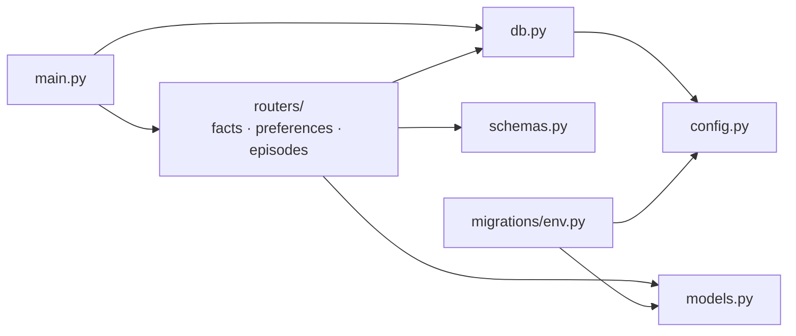

`embeddings.py` isn't in the picture yet: it imports none of these, and none of them import it until step 3.

**The eval, from the entry point down to the data files:**

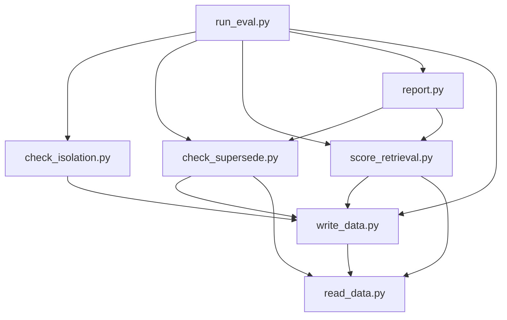

**The eval never imports the app.** It reaches the API only over HTTP, like any outside client, so it tests the real API rather than the code's internals. Only `tests/` imports both: it drives the app in-process, and passes that same in-process client to the eval code.

### 5.4 The API (`app/`)

#### Configuration: `config.py`

`Settings`, a pydantic-settings `BaseSettings`, has two fields. Values come from environment variables first, then `.env`, then these defaults:

| Field | Default | Used by |
|---|---|---|
| `database_url` | `postgresql+psycopg://mutable_app:…@localhost:5432/mutable` | The running API: a restricted user, so Row-Level Security applies |
| `admin_database_url` | `postgresql+psycopg://mutable:…@localhost:5432/mutable` | Migrations only: the superuser |

`settings = Settings()` is created once, when the module is imported.

#### Sessions and tenant scoping: `db.py`

| Name | What it is |
|---|---|
| `engine` | `create_engine(settings.database_url)`: one connection pool per process, as `mutable_app` |
| `SessionLocal` | A session factory (`autoflush=False`, `autocommit=False`) |
| `get_db()` | A dependency that opens a session, yields it, and always closes it |
| `get_tenant_id()` | A dependency that reads the `X-Tenant-Id` header as a UUID. If it's missing or not a UUID, the request gets a 422 |
| `get_tenant_db()` | A dependency that scopes the session to the tenant and owns the transaction (below) |
| `TENANT_DB` | `Depends(get_tenant_db, scope="function")`: what every tenant endpoint uses |

How an endpoint gets its session:

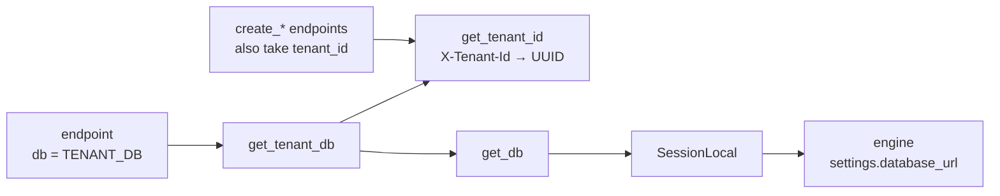

What `get_tenant_db` does on every request:

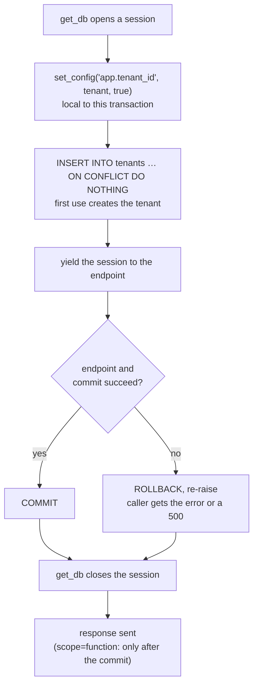

#### The app and its endpoints: `main.py` and `routers/`

`main.py` creates `app = FastAPI(title="Mutable")`, mounts the three routers, and defines three endpoints of its own. FastAPI also serves interactive docs at `/docs` and `/redoc`, and the schema at `/openapi.json`.

| Method | Path | Function | Success | Errors | Notes |
|---|---|---|---|---|---|
| GET | `/health` | `health` | 200 | — | No database access |
| GET | `/health/db` | `health_db` | 200 | 500 | `SELECT 1` through `get_db`; no tenant needed |
| GET | `/whoami` | `whoami` | 200 | 422 | Returns the tenant as the database sees it |
| POST | `/facts` | `create_fact` | 201 | 422 | |
| GET | `/facts` | `list_facts` | 200 | 422 | Current only (`valid_to IS NULL`), newest first |
| GET | `/facts/{id}` | `get_fact` | 200 | 404 | |
| DELETE | `/facts/{id}` | `delete_fact` | 204 | 404 | Permanent |
| POST | `/preferences` | `create_preference` | 201 | 404, 409, 422 | Supersede (below) |
| GET | `/preferences` | `list_preferences` | 200 | 422 | Current only, newest first |
| GET | `/preferences/{id}` | `get_preference` | 200 | 404 | Also returns closed, superseded versions |
| DELETE | `/preferences/{id}` | `delete_preference` | 204 | 404, 409 | Refused if it replaced another version |
| POST | `/episodes` | `create_episode` | 201 | 422 | End can't be before start |
| GET | `/episodes` | `list_episodes` | 200 | 422 | Current only, latest event first |
| GET | `/episodes/{id}` | `get_episode` | 200 | 404 | |
| DELETE | `/episodes/{id}` | `delete_episode` | 204 | 404 | Permanent |

Every endpoint except `/health` and `/health/db` needs the `X-Tenant-Id` header, and returns 422 without it. Endpoints are plain `def`, not `async`, so FastAPI runs them in a thread pool.

**What each status code means:**

| Code | When |
|---|---|
| 200 / 201 / 204 | Success |
| 404 | No record with that id, **or** it belongs to another tenant. The two are indistinguishable by design, so ids don't leak. |
| 409 | Superseding a preference that's already closed, or deleting a preference that replaced another |
| 422 | The body or header fails validation, or a replacement is dated before the record it replaces |
| 500 | Anything unexpected, including a failed commit. The transaction is rolled back. |

#### Creating and deleting a preference

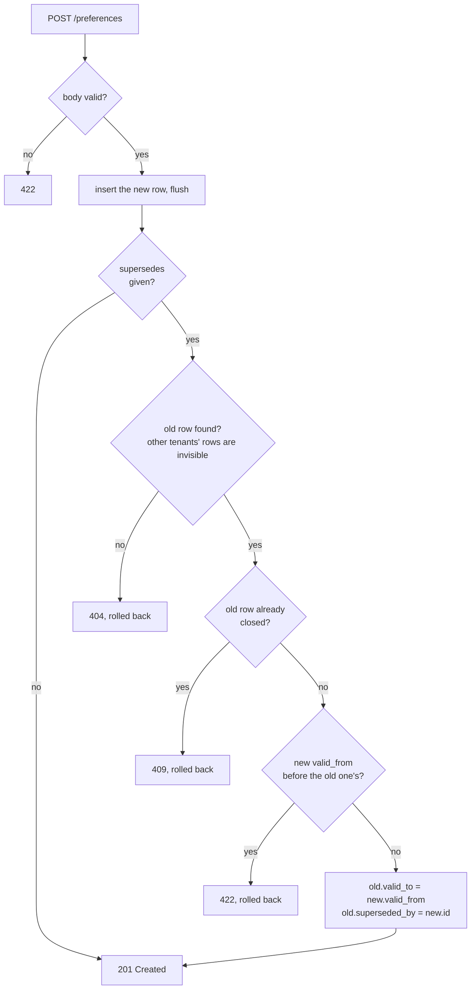

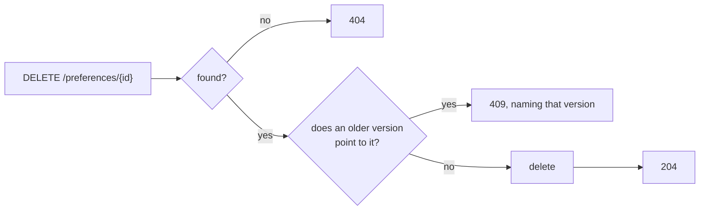

The new row is inserted *before* the supersede checks run, so its id and `valid_from` (which defaults to "now") are known. If any check fails, the whole transaction rolls back, and nothing is saved.

#### Table classes: `models.py`

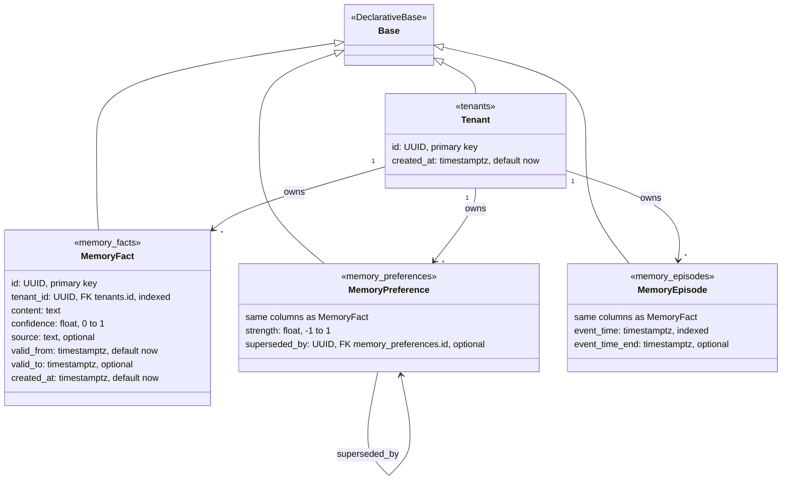

| Table | Check constraints | Indexes |
|---|---|---|
| `memory_facts` | `ck_memory_facts_confidence_range` | `ix_memory_facts_tenant_id` |
| `memory_preferences` | `ck_memory_preferences_confidence_range`, `ck_memory_preferences_strength_range` | `ix_memory_preferences_tenant_id` |
| `memory_episodes` | `ck_memory_episodes_confidence_range`, `ck_memory_episodes_time_order` (end ≥ start) | `ix_memory_episodes_tenant_id`, `ix_memory_episodes_event_time` |

The classes declare columns and foreign keys only, with no ORM `relationship()`, so every load is an explicit query. Ids are generated in Python (`uuid4`); timestamps default to the database's `now()`.

#### Request and response classes: `schemas.py`

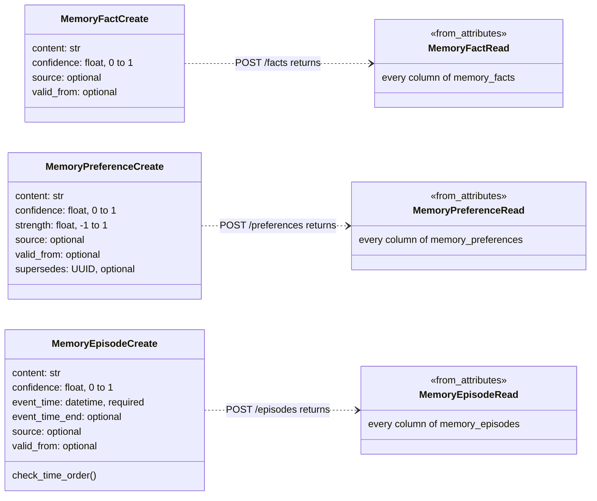

- **`*Create` classes are what a caller may send.** They have no `id` or `tenant_id`; the server sets those. Unknown fields are ignored, not rejected, which is Pydantic's default.
- **`*Read` classes are what comes back.** `from_attributes` lets them build straight from a table row.
- **An omitted `valid_from` falls through to the database default (now).** Endpoints drop empty fields before inserting (`exclude_none`).
- **`supersedes` is an instruction, not a column.** It's removed before the insert and acted on separately.

#### Turning text into vectors: `embeddings.py`

An **embedding** is a text turned into a vector: a fixed-length list of numbers. Texts that mean similar things get vectors that are close together, so search can find "prefers tea over coffee" for a question about drinks even when the words differ.

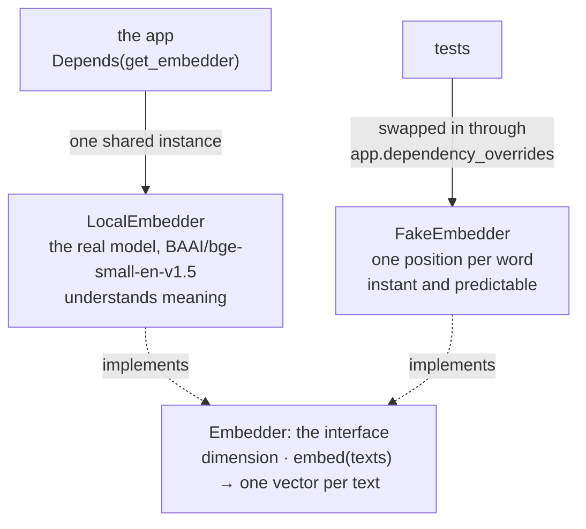

| Name | What it is |
|---|---|
| `MODEL_NAME`, `DIMENSION` | `BAAI/bge-small-en-v1.5` and 384. Every vector has 384 numbers, and the database column will be sized to match, so changing the model means a migration and embedding every record again. That's why the model is a constant, not a setting |
| `Embedder` | The interface, a `typing.Protocol`: a `dimension`, and `embed(texts)`, which returns one vector per text, in order. Code that needs vectors depends on this, not on either class |
| `LocalEmbedder` | The real one: the model, run on the CPU by fastembed. Related texts get close vectors even when they share no words. Vectors come back scaled to length 1 |
| `FakeEmbedder` | For tests. Each word adds 1 to one of the 384 numbers, picked by a checksum of the word (`zlib.crc32`), and the vector is then scaled to length 1. So the same text gets the same vector in every run, and texts that share words get closer vectors. It knows nothing about meaning |
| `get_embedder()` | The FastAPI dependency: creates one `LocalEmbedder` the first time it's called, then returns that same one (`functools.cache`). Loading the model takes a moment, so it's never done per request |

No endpoint uses the embedder yet. Step 3 embeds each record as it's written, and from then on the tests swap in `FakeEmbedder`, so they stay fast and predictable.

**Where the model comes from.** fastembed downloads the model (about 65 MB) from Hugging Face the first time it's loaded, into the folder named by the `FASTEMBED_CACHE_PATH` environment variable (fastembed's own setting), and after that reads it from disk with no network. The Docker image downloads it at build time, and CI keeps it in a cache between runs ([5.8](#58-running-it-containers-configuration-and-ci)). Anywhere else, the first use downloads it to a temporary folder.

### 5.5 The database (`migrations/`)

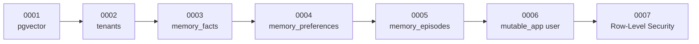

| # | What it does |
|---|---|
| 0001 | `CREATE EXTENSION vector` |
| 0002 | `tenants` table |
| 0003 | `memory_facts`, with its constraint and index |
| 0004 | `memory_preferences`, including the `superseded_by` self-reference |
| 0005 | `memory_episodes`, including the time-order constraint and the `event_time` index |
| 0006 | Creates the `mutable_app` login user. It can use the schema, and read, insert, update and delete in the four tables, but nothing else: it can't create tables or change rules |
| 0007 | Turns on Row-Level Security for all four tables, and adds the `tenant_isolation` rule to each |

The isolation rule, as created by 0007 (shown for `memory_facts`; the other tables are the same, and `tenants` checks `id`):

```sql
ALTER TABLE memory_facts ENABLE ROW LEVEL SECURITY;
ALTER TABLE memory_facts FORCE ROW LEVEL SECURITY;
CREATE POLICY tenant_isolation ON memory_facts
    FOR ALL
    USING      (tenant_id = current_setting('app.tenant_id')::uuid)   -- what can be read
    WITH CHECK (tenant_id = current_setting('app.tenant_id')::uuid);  -- what can be written
```

`FORCE` would apply the rule even to the table's owner. That's redundant today, since the owner is a superuser and superusers always bypass it, but it's cheap insurance if ownership ever changes.

**Alembic's setup:**

- **`migrations/env.py`** connects with `settings.admin_database_url`, the superuser, and points autogenerate at `Base.metadata`. `alembic check` confirms the models and migrations agree. It uses no connection pool, and supports an offline mode that only prints the SQL.
- **`alembic.ini`** holds the folder location and logging, and notes how to number the next migration: `--rev-id 0008`.
- **`script.py.mako`** is the template for new migration files.

### 5.6 The eval (`eval/`)

#### One run, as function calls

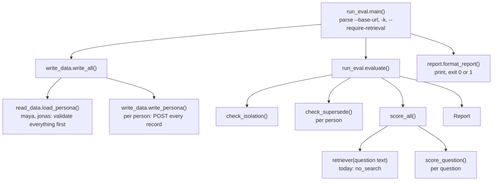

#### Reading the data: `read_data.py`

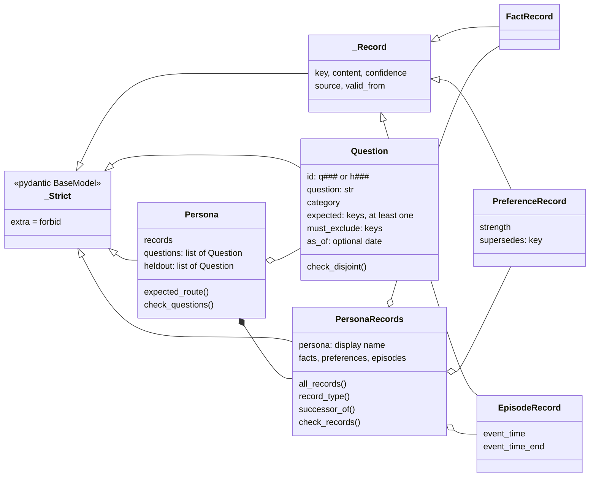

**Helpers:**

| Name | What it does |
|---|---|
| `RecordType` | `"fact"`, `"preference"` or `"episode"` |
| `TYPE_SEGMENT` | Maps the key's middle part to a type (`pref` → `preference`) |
| `Key` | The key pattern: `persona.type.slug`, with an optional `.vN` |
| `UtcDatetime` | A bare date becomes midnight UTC, and a time with no zone is UTC |
| `load_persona(name)` | Reads the persona's files and validates everything; a missing questions file counts as empty |

**Every rule a data file must pass**, checked before anything is written:

| Rule | Checked by |
|---|---|
| No unknown fields anywhere: a typo fails instead of being dropped | `_Strict` (`extra="forbid"`) |
| Keys match the pattern; confidence is 0–1, strength −1 to 1 | field types |
| No duplicate keys; a key's type matches the list it's in | `check_records` |
| `supersedes` points to an *earlier* preference in the file | `check_records` |
| Both ends of a supersede have `valid_from`, and the replacement isn't dated earlier | `check_records` |
| No preference is superseded twice; no episode ends before it starts | `check_records` |
| Question ids are `q###` (main) or `h###` (held-out), unique; question texts are unique across both sets | `check_questions` |
| `expected` is never empty, and no key is both expected and excluded | `Question` |
| Every key a question mentions exists | `check_questions` |
| Expected records of several types require the `cross_type` category | `check_questions` |
| A "current" question never expects a superseded record, and excludes every older version | `check_questions` |
| A "historical" question expects at least one superseded record, and with `as_of`, every expected preference was valid on that date | `check_questions` |

`expected_route(question)` derives the record types a correct router should search from the question's expected records, rather than from a separate label, so the two can't disagree.

#### Writing the data: `write_data.py`

| Name | What it is |
|---|---|
| `PERSONAS` | `["maya", "jonas"]`, the default set |
| `PATHS` | The API path for each record type, shared with the isolation check |
| `WrittenPersona` | One person as written: `name`, `persona`, `tenant_id`, `ids` (key → id). It also has `key_of`, the reverse lookup, and `headers`, its `X-Tenant-Id` |
| `WriteError` | Raised when the API refuses a record, naming its key |
| `write_all(client, names)` | Validates every person first, then writes each one |
| `write_persona(client, name, persona)` | Creates a new tenant and POSTs the facts, then the preferences (turning each `supersedes` key into the id it received), then the episodes |

It also works on its own: `python -m eval.write_data maya jonas` prints each tenant id and its key → id map as JSON.

#### The checks

- **`check_isolation(client, tenants)`** returns the leaks and how many probes it made. For every pair of different people, it does two things:
  - fetches each of one person's records by id, as the other person, and expects a 404
  - reads each list endpoint as the other person, and expects none of the first person's ids in it
- **`check_supersede(client, tenant)`** returns a list of failures. It reads every preference back through the API and checks four things:
  - each old version's `superseded_by` and `valid_to` match its successor
  - current versions are open and listed
  - closed versions aren't listed
  - every changed-preference question's expected and excluded records agree with the stored dates

  `evolution_questions()` selects those changed-preference questions.
- **`score_retrieval.py`** defines what a search must return, and how it's scored:

| Name | What it is |
|---|---|
| `Retrieved` | What a search returns: ranked `ids`, and optionally the `route` (record types) it chose |
| `Retriever` | The search interface: (client, tenant id, question text) → `Retrieved` |
| `no_search` | Today's placeholder retriever: finds nothing |
| `QuestionResult` | One question's score: `missing`, `excluded_hits`, `leaked`, `reciprocal_rank`, `route_ok`, plus `recall` and `passed` |
| `score_all(...)` | Asks every question for every person; returns main and held-out results separately |

How `score_question` grades one answer:

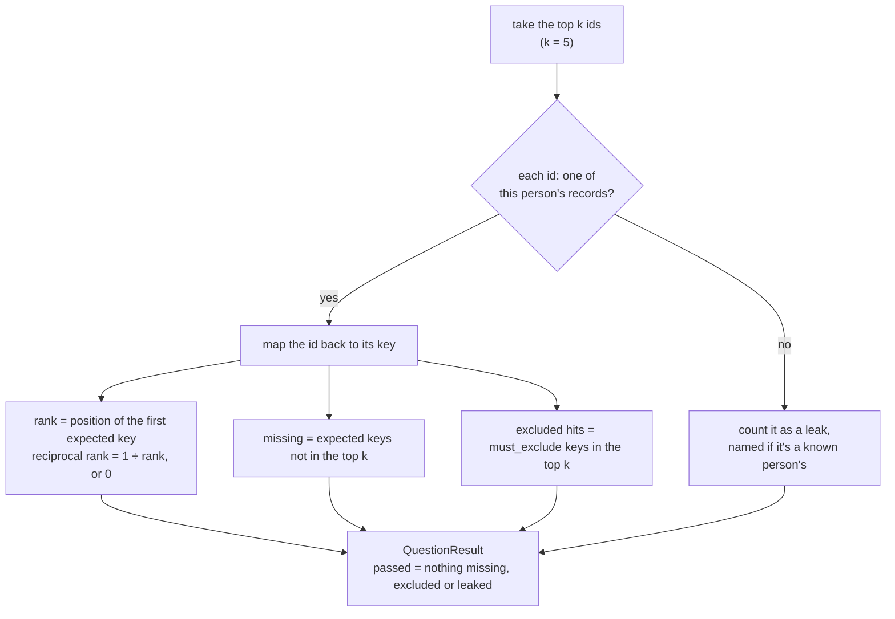

#### The verdict: `report.py` and `run_eval.py`

| Name | What it is |
|---|---|
| `RECALL_BAR`, `MRR_BAR` | 0.9 and 0.8 |
| `Report` | Everything a run found: the tenants, the retriever's name, k, isolation leaks and probe count, supersede failures, main results, held-out results |
| `Report.leaks` | Isolation leaks plus leaks in search results |
| `Report.recall`, `Report.mrr` | Averages over the main questions |
| `Report.heldout_meets_bars` | Whether the held-out averages reach both bars |
| `Report.passed(require_retrieval)` | No leaks and no supersede failures. With `require_retrieval`, both bars must also be met on the main set and the held-out set |
| `format_report(report)` | Prints the gates, a score table by category plus one held-out row, the bars, routing accuracy, each failed main question, and any held-out leaks (by id only) |
| `evaluate(client, tenants, retriever, k)` | Runs the three checks and builds the `Report` |

| Command-line flag | Default | Meaning |
|---|---|---|
| `--base-url` | `http://localhost:8000` | Where the API is running |
| `-k` | `5` | How many top results to score |
| `--require-retrieval` | off | Also fail when Recall or MRR is below the bar |

The exit code is 0 when the run passes and 1 when it fails, which is what lets CI block a pull request.

#### The data files

```yaml
# eval/data/maya/records.yaml
persona: Maya Chen
facts:
  - key: maya.fact.lives_in_lisbon
    content: Lives in Lisbon, Portugal
    confidence: 0.95
    valid_from: 2024-09-15            # optional
preferences:
  - key: maya.pref.diet.v2
    content: Is pescatarian -- eats fish, but no other meat
    confidence: 0.9
    strength: 0.8                     # -1 dislike … +1 like
    valid_from: 2025-05-01
    supersedes: maya.pref.diet.v1     # must appear earlier in the file
episodes:
  - key: maya.ep.adopted_biscuit
    content: Adopted Biscuit, an orange tabby cat, from a Lisbon animal shelter
    confidence: 0.95
    event_time: 2025-02-08
    event_time_end: …                 # optional, for multi-day events
```

`questions.yaml` and `heldout.yaml` are lists of questions in the format shown in [3.3](#33-questions-and-their-expected-answers): `id`, `question`, `category`, `expected`, plus optional `must_exclude` and `as_of`.

### 5.7 Tests (`tests/`)

```mermaid
flowchart LR
    client["client<br/>session-wide TestClient(app)<br/>no tenant"] --> tenant["tenant<br/>new per test"]
    client --> other["other_tenant<br/>new per test"]
    tenant --> tc["TenantClient<br/>id · headers · get · post · delete<br/>sends X-Tenant-Id on every request"]
    other --> tc
    client --> evaltests["eval tests<br/>pass client to write_all / evaluate"]
```

The tests follow three principles:

- **Everything runs against the real Postgres, with no mocks.** The real constraints and Row-Level Security get tested. The one exception is `test_transactions.py`, which patches `Session.commit` to fail on purpose.
- **Each test gets a brand-new tenant,** so tests can't see each other's rows, even across runs against the same database.
- **`TestClient` calls the app in-process**, with no server running, and doubles as the HTTP client for the eval code.

| File | What it proves |
|---|---|
| `test_health.py` | `/health` and `/health/db` respond |
| `test_whoami.py` | The tenant header is required, must be a UUID, and is what the database sees |
| `test_facts.py` | Create, get, list and delete. Lists are scoped to the tenant, and another tenant gets a 404. Plus the confidence range, the required header, and a backdated `valid_from` |
| `test_preferences.py` | The same, plus supersede:<br/>• closes the old version and links it to the new one<br/>• can't supersede twice (409), a missing one (404) or another tenant's (404)<br/>• backdated versions line up exactly<br/>• a replacement dated earlier is rejected and rolled back<br/>• deleting a version that replaced another is refused, but deleting the oldest is allowed |
| `test_episodes.py` | Create, get, list and delete; multi-day events; end before start (422); `event_time` required; a backdated `valid_from` |
| `test_isolation.py` | Querying Postgres directly as `mutable_app`, each tenant sees only its own rows, in all three memory tables |
| `test_transactions.py` | A failed commit returns 500, and nothing is saved |
| `test_embeddings.py` | The fake gives the same vector every time, 384 numbers scaled to length 1, and puts texts that share words closer. The real model gives 384 numbers per text, in the order of the texts, and puts "likes green tea" closer to "prefers tea over coffee" than "lives in Lisbon" is. `get_embedder` shares one model. No database needed |
| `test_read_data.py` | The shipped data is valid, and each rule rejects bad data, one case per rule |
| `test_write_data.py` | Every record is written under a fresh tenant with the right history; each run gets its own tenant; people are isolated; a refused record raises with its key |
| `test_run_eval.py` | Every gate can fail:<br/>• perfect search scores 1.0<br/>• a leak fails the run<br/>• held-out questions are gated but never listed one by one<br/>• an excluded record fails its question<br/>• a broken history chain trips the supersede check<br/>• a shared tenant trips the isolation check |

### 5.8 Running it: containers, configuration and CI

```mermaid
flowchart LR
    dev["developer machine"] -- "localhost:8000" --> api
    dev -- "localhost:5432" --> db
    subgraph compose["docker compose"]
        api["api<br/>python:3.12-slim<br/>uvicorn --reload<br/>code mounted at /app<br/>embedding model in /opt/fastembed"]
        db["db<br/>pgvector/pgvector:pg16<br/>health check: pg_isready"]
        vol[("volume: pgdata")]
    end
    api -- "db:5432 as mutable_app" --> db
    db --- vol
```

| File | What it sets |
|---|---|
| `Dockerfile` | `python:3.12-slim`; installs `requirements-dev.txt`; downloads the embedding model into `/opt/fastembed` and points `FASTEMBED_CACHE_PATH` there (outside `/app`, because compose mounts the repo over `/app` and would hide it); runs `uvicorn app.main:app --host 0.0.0.0 --port 8000 --reload` |
| `docker-compose.yml` | **db:** user, password and database `mutable`; port 5432; a health check every 5 seconds; data kept in the `pgdata` volume. **api:** both database URLs pointing at host `db`; port 8000; starts only once the db is healthy; mounts the repo at `/app` for live reload |
| `.env.example` | The same two URLs pointing at `localhost`, for running outside Docker. Copy it to `.env` |
| `pyproject.toml` | **Ruff:** 100-character lines, Python 3.12, rule sets E, F, I and UP. **pytest:** the `tests/` folder, with the project root on the import path |
| `requirements.txt` / `requirements-dev.txt` | Runtime libraries / plus pytest, httpx, Ruff and PyYAML |
| `.gitignore`, `.dockerignore` | Keep the virtual environment, caches and `.env` out of git and out of the image |

CI, in `.github/workflows/ci.yml`, runs on every pull request and on every push to `main`:

```mermaid
flowchart LR
    trig["pull request,<br/>or push to main"] --> pg["Postgres service<br/>pgvector:pg16"]
    pg --> py["Python 3.12,<br/>install requirements-dev"]
    py --> lint["ruff check"]
    lint --> model["embedding model:<br/>restore from the cache,<br/>download on a miss"]
    model --> mig["alembic upgrade head"]
    mig --> test["pytest"]
    test --> up["start uvicorn,<br/>wait for /health"]
    up --> ev["python -m eval.run_eval<br/>report → job summary"]
    ev --> gate{"exit code 0?"}
    gate -- yes --> pass["check passes"]
    gate -- no --> fail["check fails;<br/>print the API log"]
```

CI installs everything on the runner directly, not in Docker, so it keeps the embedding model in its own cache (`actions/cache`): the folder `FASTEMBED_CACHE_PATH` names, under a key that names the model. Loading the model before the tests means they never wait on a download; it downloads only when the cache is empty, such as after the key changes.
