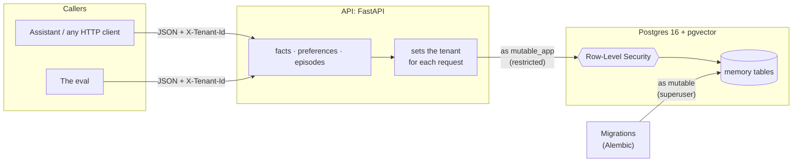
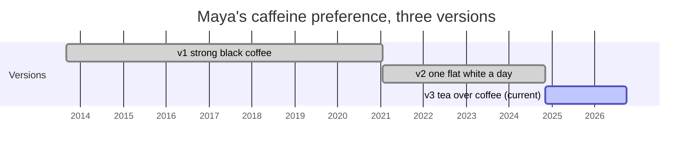
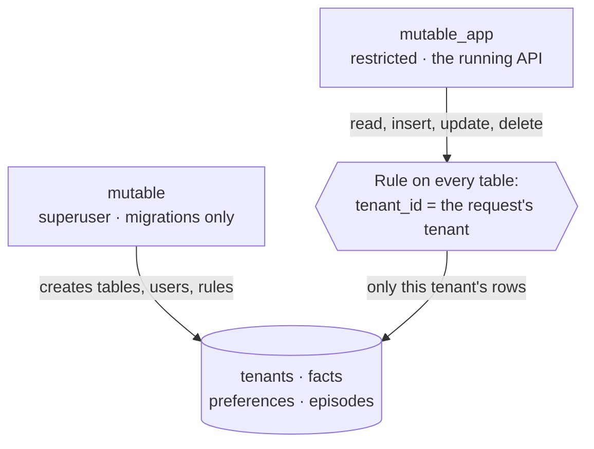
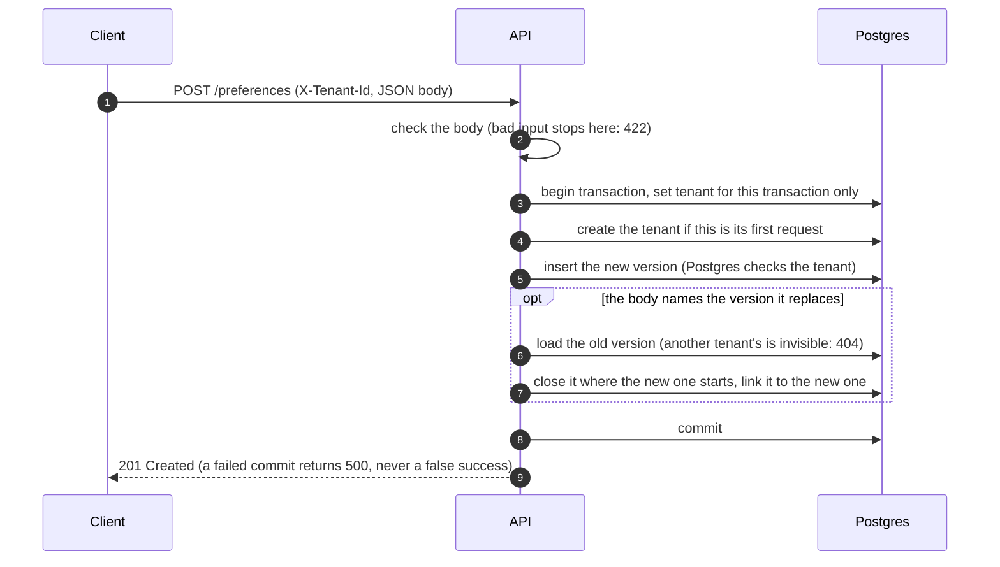
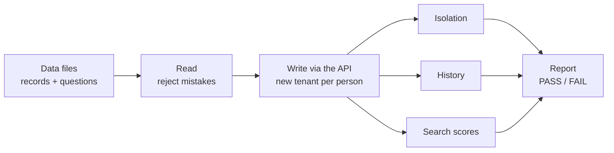
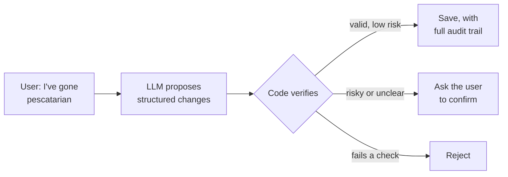

# Mutable: Design Overview

> Memory for an AI assistant that knows when something it remembers has changed.

**In 30 seconds.** An assistant's memory has to change as the person changes. Maya was vegetarian for nine years; in May 2025 she became pescatarian. Ask "what does she eat?" and the answer must be *pescatarian*, never the outdated *vegetarian*. Ask "was she vegetarian in 2023?" and the answer must still be *yes*.

Mutable does four things to make that work:

- It stores every version of a memory.
- It knows which version is true now.
- It walls off each user's memories inside the database itself.
- It grades itself against a fixed exam on every change.

**Status, October 2026.** Storage, isolation and the eval are built and tested (milestones 1–3). Search, the part that recalls memories, is being built now (milestone 4).

| Section | |
|---|---|
| [1. Architecture](#1-architecture) | How it works, and why it's built this way |
| [2. Roadmap](#2-roadmap) | What's done, what's next, and how each step is checked |
| [3. Evaluation](#3-evaluation) | How we prove it remembers correctly |
| [4. Gaps and open problems](#4-gaps-and-open-problems) | What doesn't work yet, and the plan for each |

---

## 1. Architecture

### 1.1 The system at a glance



Mutable is a web API in front of a Postgres database:

- **Every request names its tenant.** The `X-Tenant-Id` header says whose memory the request is about; each user's private space is called a *tenant*.
- **The API connects as a restricted database user.** Row-Level Security always applies to `mutable_app`.
- **Only migrations use the superuser.** `mutable` creates tables, users and security rules, and never serves a request.

### 1.2 Memories: three types, versions instead of overwrites

| Type | Example | Can it change? |
|---|---|---|
| **Fact** | "Lives in Lisbon" | Not yet (see [gap 4.5](#45-facts-cant-change-yet)) |
| **Preference** | "Prefers tea over coffee" | Yes. A new version supersedes the old one, and the old one is kept. |
| **Episode** | "Adopted a cat in February 2025" | No. It's an event that happened. |

Each type has its own table. All three share the same core columns:

- `id`
- `tenant_id`
- `content`
- `confidence` (0–1)
- `source`
- `valid_from` and `valid_to` (an empty `valid_to` means current)
- `created_at`

Preferences add `strength`, from −1 (dislike) to +1 (like), and `superseded_by`. Episodes add `event_time` and `event_time_end`.

**How a change is stored.** Nothing is overwritten. The old version is closed exactly when the new one starts, and points to its replacement:



- **"What does she drink now?"** reads the version with no end date.
- **"What did she drink in 2022?"** reads the version whose dates contain 2022.
- **History can be backdated.** A caller may set `valid_from` in the past to record real history.
- **A replacement can't predate what it replaces,** and a version that's already closed can't be replaced again. So each chain has exactly one current version.

### 1.3 Isolation: the database keeps users apart



- **Each request tells Postgres which tenant it's acting for,** at the start of its transaction.
- **A Postgres rule on every table hides all other tenants' rows,** for reading and for writing. The Python code never filters by user, so a forgotten filter can't leak data.
- **If no tenant is set, the rule raises an error** instead of quietly matching nothing.
- **It's tested twice.** A test queries Postgres directly as the API's user. The eval also tries to reach every one of Maya's records as Jonas, and every one of his as her, on every pull request.

### 1.4 One request, step by step

Replacing a preference is the most involved write:



Three details make this safe:

- **The tenant setting dies with the transaction.** Database connections are reused across requests, so a setting that outlived its transaction could leak one request's tenant into the next.
- **Tenants are created on first use, with no sign-up.** That's safe from other tenants, because the tenants table has the same rule: a caller can only create its own tenant. It doesn't prove who the caller is; see [gap 4.7](#47-no-authentication-yet-and-the-roadmap-deploys-first).
- **The commit happens before the response is sent.** A failure can never be reported as a success.

### 1.5 Key decisions

| Decision | Chosen | Instead of | Why |
|---|---|---|---|
| Isolating users | Postgres Row-Level Security | `WHERE tenant_id = …` in code; a schema or database per user | One forgotten filter leaks data. Per-user schemas multiply every migration. |
| Where vectors live | pgvector, inside Postgres | A separate vector database | One isolation mechanism instead of two |
| Table layout | Three typed tables | One table with a JSON payload | Real columns and constraints for each type |
| History | `valid_from` / `valid_to` + `superseded_by` | Overwriting; a separate audit log | "What did she use to…" is an ordinary query |
| Input | Structured JSON only, for now | Free text read by an LLM | Writes stay predictable and auditable. Free text is milestone 8 (see [gap 4.2](#42-updating-memory-reliably-and-the-llm-problem)) |
| Search routing (planned) | Rules first | An LLM router | Fast, free and predictable. The eval can compare the two later. |

### 1.6 The stack

| Tool | Role |
|---|---|
| **FastAPI + Pydantic** | The HTTP API. Requests are checked against typed schemas, and the tenant is attached to every request. |
| **PostgreSQL 16** | Storage, constraints, Row-Level Security |
| **pgvector** | Vector search inside Postgres, used from milestone 4 |
| **SQLAlchemy + Alembic** | Tables as Python classes; numbered migrations `0001`–`0007` |
| **Docker Compose** | The same database and API for every developer; milestone 6 deploys this same setup |
| **pytest** | Tests run against a real Postgres, so the real isolation rules get tested |
| **GitHub Actions** | Lint, tests and the full eval on every pull request |

---

## 2. Roadmap

Each milestone ships something that runs and can be checked on its own.

| # | Milestone | What the user gets | Done when | |
|---|---|---|---|---|
| 1 | Scaffold | The foundation | Postgres, migrations and CI run | ✅ |
| 2 | Storage | Memories stored, versioned, private to each user | One tenant provably can't read another's rows, even querying Postgres directly | ✅ |
| 3 | Eval | "Remembering correctly" defined and checked on every change | The eval runs on every pull request: 0 leaks, correct history | ✅ |
| 4 | **Search** | **Ask a question, get the right memories** | **Recall@5 ≥ 0.9 and MRR ≥ 0.8, including held-out questions** | 🚧 |
| 5 | Caching | Recall feels instant | Faster in p95 latency, with identical eval scores | |
| 6 | Deploy | Reachable on the internet | A live endpoint; a pull request that breaks isolation can't merge | |
| 7 | Accounts | Users sign up and get their own key | A real login flow issues keys that the same isolation rule enforces | |
| 8 | Free-text input | "I've gone pescatarian" becomes the right memory | Plain text produces the same records a structured request would, reviewable before saving | |
| 9 | Answers | A direct answer, citing its sources | Every answer cites the ids of the memories it used | |
| 10 | Client app | Usable by people who aren't developers | Someone else can add and look up memories without curl | |
| 11 | Documents | Ask about whole documents | The right passage is returned, checked against its own questions | |
| 12 | Agent actions | The assistant acts on what it knows | A real action, with an audit trail back to the memory behind it | |

### 2.1 Now: milestone 4, search

**Goal.** Before the assistant answers or acts ("book me dinner on Friday"), it asks its memory a plain question ("what should I know about Maya's food?"). It should get back the right records (pescatarian, shellfish allergy, dislikes cilantro) and never the outdated "vegetarian".

**Design.**

- `/search` returns ranked records, not prose; prose answers are milestone 9.
- Each record's meaning is turned into a vector when it's written.
- Search combines vector similarity, for meaning, with full-text search, for exact words like names.
- A rule-based router decides which record types to search, and the time scope:
  - **now**, the default
  - **as of a date:** "back in 2023"
  - **full history:** "used to"
- Out-of-date versions are filtered out by date, not just ranked lower.

**Built in ten small steps,** one pull request each:

| # | Step | |
|---|---|---|
| 1 | Held-out questions: 20 more, never used for tuning | ✅ |
| 2 | Embedding model behind one interface, plus a predictable fake for tests | |
| 3 | Store each record's vector and full-text index when it's written | |
| 4 | `/search` v1: vector search over current records. The eval calls it, giving the first real scores | |
| 5 | Hybrid search: add full-text, merge both rankings | |
| 6 | Router, time scope: now, as of a date, or full history | |
| 7 | Router, record types: which tables to search | |
| 8 | Episode dates: "in October 2025", "most recent" | |
| 9 | Reach the score targets; check the held-out score once, at the end | |
| 10 | Make CI fail any pull request that misses the targets | |

---

## 3. Evaluation

### 3.1 Why

You can't tell whether search is good by trying a few questions by hand. Every change to search can quietly break questions nobody tried. And Mutable's main promise is easy to get wrong: a search that matches on words will happily return "Is vegetarian", because it mentions diet just as much as "Is pescatarian" does.

So the eval is **an exam with an answer key, run on every pull request.** It was written in milestone 3, before any search code, so the definition of "good" was fixed before anything could be tuned to pass it.

### 3.2 The test data

Both people are fictional, so there's no real personal data in the repo.

- **Maya** has 100 records: facts, preferences that change over time (diet, caffeine, travel style…), and a dated timeline of events. All the questions are about her.
- **Jonas** has 28 records and exists only to catch leaks. His details differ from Maya's but cover the same topics (city, job, allergies, coffee), so a leaked record would actually rank in her results, and be caught.

### 3.3 Questions and their expected answers

Each question lists the records a correct answer must include, and sometimes the outdated ones it must not:

```yaml
- id: q001
  question: What's Maya's diet these days?
  expected: [maya.pref.diet.v2]        # "Is pescatarian": must be in the top 5
  must_exclude: [maya.pref.diet.v1]    # "Is vegetarian": must not appear at all
```

| Category | Questions | What it checks |
|---|---|---|
| Changed preference, now | 10 | The current version is found, and every older version is excluded |
| Changed preference, in the past | 10 | An older version is still found; 7 of these pin a date |
| Facts | 24 | Plain lookups, some needing two records |
| Stable preferences | 13 | Including near-duplicates that are easy to confuse |
| Episodes | 12 | Dates, "most recent", several answers |
| Across types | 6 | "Why" questions linking a change to the event that caused it |

**20 held-out questions** follow the same rules but are never used to tune search. The eval reports only their total score, never question by question. If search does well on the 75 and poorly on these 20, it was tuned to the questions rather than getting better in general.

### 3.4 What's checked

| Check | What it proves | Today |
|---|---|---|
| **Isolation** *(must pass)* | Every one of Maya's records, requested as Jonas, returns "not found", and the reverse. No foreign record ever appears in a list or a search result. | ✅ 0 leaks |
| **History** *(must pass)* | Each old version links to its replacement and ends exactly when it starts, and only the newest version is current | ✅ 0 failures |
| **Recall@5** | The share of expected records found in the top 5 results | 0.00 (no search yet) |
| **MRR** | How high the first right answer ranks: 1st = 1, 2nd = ½, 3rd = ⅓ | 0.00 (no search yet) |
| **Excluded hits** | Outdated records returned. Each one fails its question, even if the right record was found too. | — |

**The target for milestone 4:** Recall@5 ≥ 0.9 and MRR ≥ 0.8, on both the 75 questions and the 20 held-out.

### 3.5 One run



- **Records go in through the public API,** not straight into the database. The eval exercises the same checks, history logic and isolation that a real caller hits.
- **Search receives only the question text,** never the expected answers.
- **Each run uses brand-new tenants,** so runs can't interfere with each other.

---

## 4. Gaps and open problems

Mutable today stores, versions and isolates memories correctly, and proves it on every change. This section is what it does **not** do yet, or does in a way we know is fragile.

| # | Gap | Impact | Plan | When |
|---|---|---|---|---|
| [4.1](#41-two-preferences-true-at-the-same-time) | Two preferences true at the same time | High | Topics, explicit add-or-replace, context | Before milestone 8 |
| [4.2](#42-updating-memory-reliably-and-the-llm-problem) | Updating memory reliably with an LLM | High | The LLM proposes, code verifies, risky changes are confirmed | Milestone 8 |
| [4.3](#43-whose-memory-is-it) | Whose memory is it? | Medium | A subject on every memory | Before milestone 8 |
| [4.4](#44-mistakes-and-forgetting) | Mistakes vs changes, and forgetting | Medium | Retract and erase operations | Before milestone 8 |
| [4.5](#45-facts-cant-change-yet) | Facts can't change yet | Medium | Versions for facts too | Before milestone 8 |
| [4.6](#46-memories-go-stale-silently) | Memories go stale silently | Medium | "Last confirmed" date; re-ask | Milestone 9+ |
| [4.7](#47-no-authentication-yet-and-the-roadmap-deploys-first) | No authentication, and the roadmap deploys first | Critical before launch | Accounts before deploying | Milestones 6–7 |
| [4.8](#48-sensitive-data) | Sensitive data | High before launch | Encryption, LLM data terms, read audit | Milestones 6–8 |
| [4.9](#49-search-is-not-built-yet) | Search is not built yet | High | Milestone 4, in progress | Milestone 4 |
| [4.10](#410-the-eval-is-small-and-synthetic) | The eval is small and synthetic | Medium | More personas, independent questions, an extraction eval | Milestones 4–8 |
| [4.11](#411-operations-and-scale) | Operations and scale | Low today | Backups, monitoring, index design | Milestones 5–6 |

### 4.1 Two preferences true at the same time

**The case.** Maya "prefers coffee" and "prefers tea". There are three possibilities:

- Both are true: coffee in the morning, tea in the evening.
- The second replaced the first: she switched.
- One is about someone else: Sam, her partner, prefers coffee.

**Today:**

- **Both are stored as separate current preferences.** Nothing stops two current preferences on the same topic.
- **Only the caller decides whether the new one replaces the old,** by naming it (`supersedes: <id>`). If the caller doesn't, both stay current, even if they contradict each other.
- **Mutable doesn't know the two are about the same topic.** The topic exists only in the free text.
- **Conditions like "in the morning" aren't modeled.** They can only be written into the text, so search can't pick the version that applies right now.
- **The eval doesn't test this.** Every change in Maya's data is an explicit, linked replacement, and her other preferences never conflict.

**Plan:**

1. **A topic on every preference,** for example `drink.caffeine`, so "same subject" is data, not guesswork.
2. **Every write declares its intent:** *add* (both stay true) or *replace*. If a topic already has a current preference, a write that doesn't say which is rejected, not guessed.
3. **An optional context,** such as "mornings" or "at work", so coexisting preferences say when each applies.
4. **Likely contradictions are flagged for confirmation:** same topic, opposite strength, no declared intent. They're never silently kept side by side.
5. **Eval questions for coexisting and conditional preferences,** such as "What should I make Maya at 9 pm?".

### 4.2 Updating memory reliably, and the LLM problem

**Today, no LLM writes to memory.** The caller sends structured JSON and names exactly which record it replaces. Writes are predictable and auditable, but only because someone else has already done the hard part correctly.

**Milestone 8 changes that.** Users will just talk ("I've gone pescatarian"), and an LLM will turn that into records. This is where reliability gets hard:

| Risk | Example |
|---|---|
| **Invented memory** | "Had sushi once" becomes "loves sushi" |
| **Wrong target** | "Sam prefers coffee" replaces *Maya's* tea preference |
| **Misread meaning** | Negation ("I'm *not* vegan"), hypotheticals ("if I were vegan…"), temporary states ("off coffee this week") |
| **Inconsistency** | The same sentence produces different records on different runs. LLMs are not deterministic. |
| **Silent damage** | A wrong replacement closes a correct memory, and the assistant now treats something false as current |

**Design principle: the LLM proposes; deterministic code decides.** The LLM never writes to the database.



| # | Safeguard | What it prevents |
|---|---|---|
| 1 | **A fixed schema.** The LLM can only fill in: action (add / replace / ignore), type, topic, subject, content, and the record being replaced. Anything else is rejected. | Free-form writes |
| 2 | **Every proposal quotes its evidence.** It includes the exact words from the user's message, and code checks that quote appears in the message. No quote, no write. | Invented memories |
| 3 | **The LLM picks targets; it can't invent them.** Code looks up the current records on that topic and offers their ids as a short list. The LLM picks one or none. Code then checks the target exists, is current, belongs to this user, and has the same type. | Wrong or made-up targets |
| 4 | **Risky changes need confirmation.** Replacements, low-confidence proposals, and anything sensitive (health, allergies) are confirmed with the user first: "Did you stop being vegetarian?" | Silent damage |
| 5 | **Everything is reversible.** A replacement never deletes the old version, so undo is cheap: reopen the old one, close the new one. Every write records its source message, model and prompt version. | Unrecoverable mistakes |
| 6 | **Non-determinism is made harmless.** Temperature 0 and a pinned model version reduce variation but don't remove it. So a repeated request never writes twice, a proposal identical to an existing memory is a no-op, and consistency is measured rather than assumed. | Duplicates and drift |
| 7 | **An extraction eval.** Messages with their expected changes, including traps (negation, other people, hypotheticals, temporary states), run several times. It scores wrong writes first, because a missed memory is better than a false one, and also checks agreement between runs. | Regressions going unnoticed |

None of this is built yet. Today's writes are reliable precisely because no LLM is involved.

### 4.3 Whose memory is it?

**Everything in a tenant is assumed to be about the user.** Facts about other people are stored as text ("Sam, her partner, is a photographer"). Nothing distinguishes "Sam prefers coffee" from "Maya prefers coffee", so search, and later the LLM, can confuse them.

**Plan:** a **subject** on every memory: the user, or a named person. It's required before free-text input (4.2), because mixing up who something is about is one of the most likely extraction errors.

### 4.4 Mistakes and forgetting

**A correction is not a change.** "She moved in 2023, not 2024" means the old record was *never* true. Today there are only two tools, and both are wrong for this:

- **Replacing** the record would preserve the mistake as history.
- **Deleting** it is permanent. And for a preference that replaced another, deleting is refused, so its chain doesn't break.

**Forgetting is a requirement too.** Users must be able to make Mutable forget, for privacy law and for trust. Today, erasing a changed preference means deleting its versions oldest-first.

**Plan:** two explicit operations.

- **Retract:** the record is marked wrong. It's hidden from all answers but kept for audit.
- **Erase:** the record is removed permanently, with every version, its vector and any cached copy.

### 4.5 Facts can't change yet

Only preferences have versions. If Maya moves, "Lives in Lisbon" can't be replaced; today it has to be deleted, or written in the past tense ("lived in Toronto until 2024"). Facts already have the date columns.

**Plan:** use the same supersede mechanism for facts. It's a small change.

### 4.6 Memories go stale silently

A preference stated in 2019 and never updated is treated as current today, with full confidence. There's no "last confirmed" date, and confidence never decays.

**Plan:** record when each memory was last confirmed, weigh older ones lower in search, and have the assistant re-check old, important memories.

### 4.7 No authentication yet, and the roadmap deploys first

**The API trusts any `X-Tenant-Id`.** Isolation stops tenants seeing each other; it doesn't stop someone from claiming to be a tenant. Tenant ids are long random UUIDs, hard to guess, but they're identifiers, not secrets.

**The roadmap puts deploying (milestone 6) before accounts (milestone 7).**

> **Recommendation:** build accounts before deploying, or keep the deployed API private (reachable only from known addresses) until milestone 7.

### 4.8 Sensitive data

Memories include health details (allergies), relationships and locations. Isolation between users is strong. The rest isn't built yet:

- encryption beyond the disk's own
- a log of who read what
- a retention policy

**Milestones 8 and 9 would send personal text to an LLM provider.** That needs a provider that doesn't train on the data or keep it, and only the minimum text should be sent.

### 4.9 Search is not built yet

**The core value is unproven.** Recall is what users actually experience, and today it scores 0 because it doesn't exist. The targets (Recall@5 ≥ 0.9, MRR ≥ 0.8) are goals, not results.

**Known weak spots, even after milestone 4:**

- **Implicit time is out of reach for rules.** For "What was her coffee habit *when she was at university*?", rules can't turn the phrase into a date, so old and new versions both come back. 2 of the 75 questions are like this. An LLM router is the likely fix.
- **Approximate vector indexes and Row-Level Security interact at scale.** Together they can return fewer results than asked for, because the security filter runs after the approximate search has narrowed the candidates. That's fine at today's size, but it must be designed for before there are many users.

### 4.10 The eval is small and synthetic

- **It's narrow.** It's one rich persona with 75 + 20 questions, in English, hand-written by the people building search. Real users phrase things differently.
- **The held-out questions were written by the same author.** They limit overfitting, but they'd be stronger written by someone independent.
- **Some things aren't measured yet:**
  - extraction quality (4.2)
  - coexisting preferences (4.1)
  - latency (from milestone 5)
  - cost

**Plan:**

- more personas, with questions written by someone outside the team
- real phrasing from consenting users, anonymized, once available
- an extraction eval as part of milestone 8

### 4.11 Operations and scale

There are no backups, no monitoring and no load testing yet. Endpoints are synchronous, on a single Postgres. That's fine for development. Operations are milestones 5–6.

### Proposed roadmap changes

These follow from the gaps above:

1. **Accounts before deploy** (4.7): swap milestones 6 and 7, or deploy privately.
2. **Before free-text input (milestone 8)**, add to the data model:
   - topic and add-or-replace intent (4.1)
   - subject (4.3)
   - retract and erase (4.4)
   - versions for facts (4.5)
3. **Milestone 8 is done only when** the extraction eval (4.2) passes, with zero wrong writes on its trap cases.
