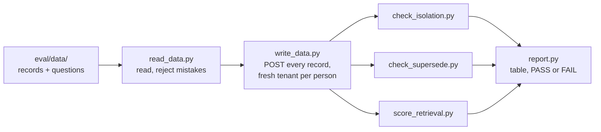
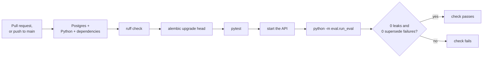
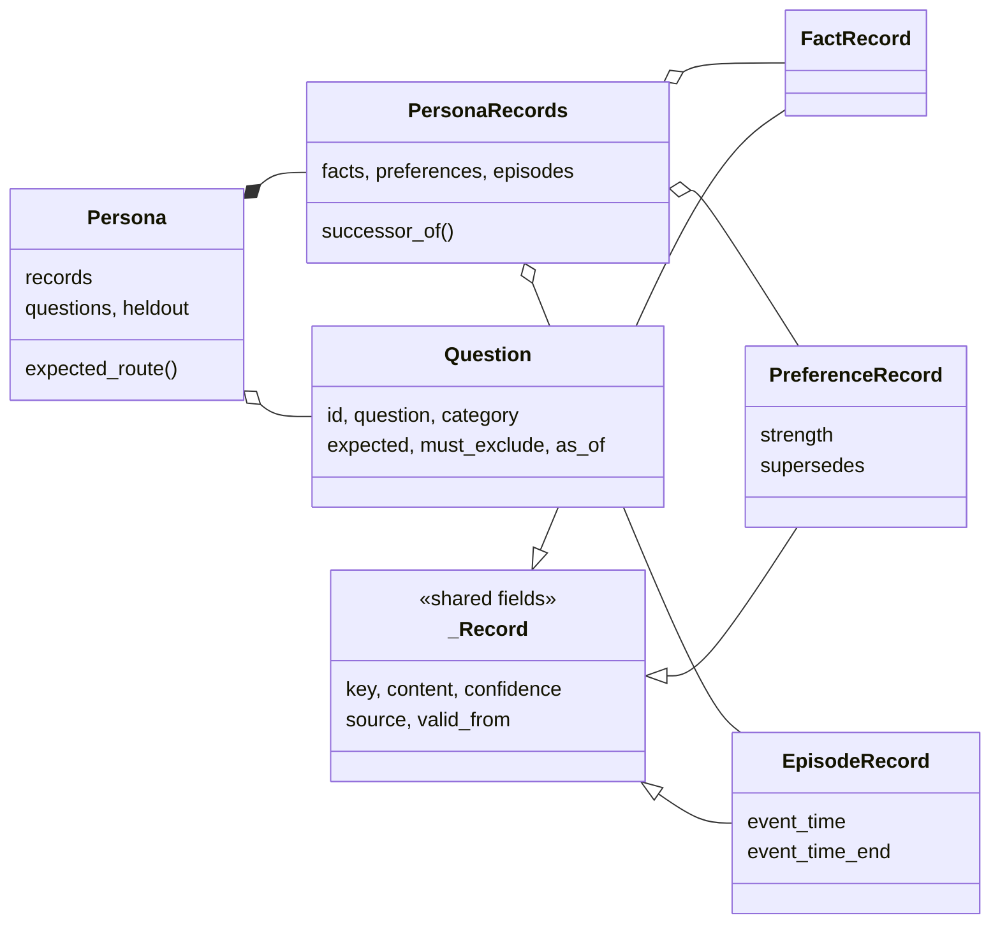
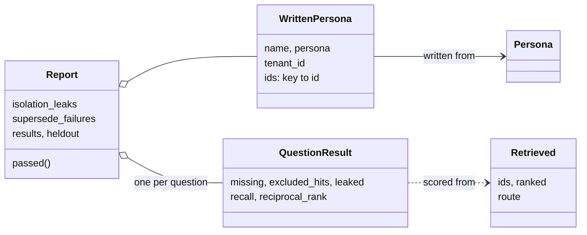

# The eval

How Mutable checks, on every pull request, that it remembers correctly. Terms are defined in the [glossary](../README.md#glossary).

## Why it exists

Milestone 4 builds search: ask "What's Maya's diet these days?" and get back the right memories. Trying a few searches by hand can't tell you whether search is good. Worse, every change to search can quietly break questions you didn't try. And Mutable's main promise is easy to get wrong: a search that matches words will happily return the outdated "Is vegetarian", because it mentions diet just as much as "Is pescatarian" does.

So the eval is an exam with an answer key, run automatically:

1. Invent people, and write down everything Mutable "remembers" about them.
2. Write questions whose correct answers are known in advance.
3. Let the system answer, and grade it.

It was built in milestone 3, **before** search, so the definition of "good" was fixed before any search code could be tuned to pass it.

## The people

Both are fictional, so there's no real personal data in the repo. [eval/personas.md](../eval/personas.md) describes them in full.

- **Maya** has 100 records: facts, preferences that change over time (diet, caffeine, travel style…), and a dated timeline of episodes. All the questions are about her.
- **Jonas** has 28 records and no questions. He exists only to catch leaks. His details are different from Maya's, but cover the same topics: where he lives, his job, his allergies, his coffee. So if one of his records ever leaked into Maya's search results, it would actually rank and be caught.

Each record has a readable name, its **key**, such as `maya.pref.diet.v2`:

| Part | Meaning |
|---|---|
| `maya` | whose record it is |
| `pref` | the type: `fact`, `pref` (preference) or `ep` (episode) |
| `diet` | the topic |
| `v2` | the version; `v1` is the older one it replaced |

The data lives in [eval/data/](../eval/data/), one folder per person.

## The questions and their expected answers

Each question lists the records a correct answer must include, and sometimes records it must *not* include:

```yaml
- id: q001
  question: What's Maya's diet these days?
  category: preference_current
  expected: [maya.pref.diet.v2]        # must be in the top 5 results ("Is pescatarian")
  must_exclude: [maya.pref.diet.v1]    # must not appear at all ("Is vegetarian", outdated)
```

A question about the past can pin a date:

```yaml
- id: q002
  question: Was Maya vegetarian back in 2023?
  category: preference_historical
  expected: [maya.pref.diet.v1]
  must_exclude: [maya.pref.diet.v2]
  as_of: 2023-06-01
```

Maya has **75 questions** in [questions.yaml](../eval/data/maya/questions.yaml), weighted toward what makes Mutable different:

| Category | Count | What it checks |
|---|---|---|
| `preference_current` | 10 | The current version of a changed preference, with every older version excluded |
| `preference_historical` | 10 | An older version can still be found; 7 of these pin a date |
| `fact` | 24 | Plain lookups, some with two expected records (both allergies, both languages) |
| `preference` | 13 | Preferences that never changed, including near-duplicates that are easy to confuse |
| `episode` | 12 | Dates, "most recent", and questions with several answers (all her talks) |
| `cross_type` | 6 | "Why" questions that pair a changed preference with the event that caused it |

### Held-out questions

**20 more** questions in [heldout.yaml](../eval/data/maya/heldout.yaml) follow the same rules but are **never used to tune search**. The eval reports only their total score, never question by question, so there's no list of failures to fix one at a time. If search scores well on the 75 but poorly on these 20, it was tuned to the questions instead of getting better in general.

They were written before any search code existed, with the same mix of categories. Nine of them ask about records no main question touches.

## One run, step by step



| Step | File | What it does |
|---|---|---|
| 1. Read | [read_data.py](../eval/read_data.py) | Loads the YAML and rejects mistakes before anything is written: a typo'd field, an unknown key, a "current" question whose expected answer is actually outdated |
| 2. Write | [write_data.py](../eval/write_data.py) | Creates a brand-new tenant for each person and sends every record through the public API, the same way a real client would |
| 3. Check | `check_isolation.py`, `check_supersede.py`, `score_retrieval.py` | The three checks below |
| 4. Report | [report.py](../eval/report.py) | Prints the table and decides PASS or FAIL |

[run_eval.py](../eval/run_eval.py) runs the steps in order.

**Why records go in through the API, not straight into the database:** so the eval also exercises the API's input checks, the supersede logic and the isolation rule, exactly as a real caller would.

**How records keep their names.** The database gives each record a random id when it's created, and each run creates everything again under new tenants, so the ids change every run. Step 2 remembers which id each key received:

```
POST /preferences {"content": "Is vegetarian",  "valid_from": "2016-01-01"}
  → the API returns id A                    remember: diet.v1 = A
POST /preferences {"content": "Is pescatarian", "valid_from": "2025-05-01", "supersedes": A}
  → the API returns id B, and closes A      remember: diet.v2 = B
```

When search later returns id B, the eval looks it up, sees it's `maya.pref.diet.v2`, and compares it with the question's expected records.

## What gets checked

### Isolation (must always pass)

As Jonas, the eval requests every one of Maya's records by id and must get `404 Not Found` every time. It also reads every list as Jonas, and none of Maya's records may appear. Then it does the same the other way round. Any of Jonas's records in Maya's search results also counts as a leak.

### Supersede (must always pass)

The eval reads Maya's preferences back through the API and checks the stored history:

- Each old version points to the version that replaced it.
- Each old version ends exactly when its replacement starts.
- Only the newest version is listed as current.

It also checks that every preference question agrees with the stored history. For example, a "current" question's expected record really is current.

### Search (scored now; must pass from milestone 4)

For each question, the eval sends **only the question text** to the search and gets back a ranked list. It never sends the expected answers. It then grades the top 5 results:

| Score | What it measures | Example |
|---|---|---|
| **Recall@5** | The share of expected records found in the top 5 | 2 of 3 found = 0.67 |
| **MRR** | How high the first expected record ranks: 1 ÷ its position | 1st = 1.0, 2nd = 0.5, 3rd = 0.33, missing = 0 |
| **Excluded hits** | `must_exclude` records that showed up | Returning "Is vegetarian" fails the question, even if "Is pescatarian" was found too |
| **Routing accuracy** | Whether search looked in the right record types | Reported once search reports where it looked |

Search doesn't exist yet, so today the eval uses a placeholder that finds nothing, and Recall and MRR read 0.00. Milestone 4 is done when both sets of questions reach these bars:

| Score | Bar |
|---|---|
| Recall@5 | ≥ 0.9, on the 75 questions and on the 20 held-out |
| MRR | ≥ 0.8, on the 75 questions and on the 20 held-out |
| Leaks | 0, always |

## The report

A run prints something like this, followed by every failed main question and what it missed:

```
Mutable eval -- wrote maya: 100 records, jonas: 28 records; retriever: no_search

Gates
  Cross-tenant leaks      0   ok     (134 isolation probes + retrieval results)
  Supersede failures      0   ok     (10 supersede links, 20 preference-evolution questions)

Retrieval (k=5)              n   Recall@5     MRR   excluded hits
  cross_type                  6       0.00    0.00               0
  ...
  all                        75       0.00    0.00               0
  held-out                   20       0.00    0.00               0
  Bars: Recall@5 >= 0.9 FAIL, MRR >= 0.8 FAIL; held-out FAIL  (not gating; pass --require-retrieval)

...
PASS
```

It fails, and exits with an error code, on any leak or any supersede failure. With `--require-retrieval` it also fails when Recall or MRR is below the bar on either set of questions.

## In CI



The report is also written to the run's summary page, readable from the pull request's Checks tab. CI starts passing `--require-retrieval` at the end of milestone 4.

## Design decisions

| Decision | Chosen | Alternative | Why |
|---|---|---|---|
| Where the data comes from | Two fictional people, written by hand | Real data; data generated by an LLM | No real personal data in the repo; hand-written answers can be trusted |
| How records get in | Through the public API | Straight into the database | Exercises the same checks, supersede logic and isolation a real caller hits |
| How records are named | Stable keys (`maya.pref.diet.v2`) | Database ids in the files | Ids are assigned by the server; keys are readable and stable |
| Re-runs | A new tenant every run | Wiping the database | Nothing to clean up; runs can't interfere with each other |
| What search sees | Only the question text | The expected answers | A search that could see the answers would score meaninglessly |
| Guarding against overfitting | 20 held-out questions, reported only as a total | Tuning against every question | A list of failures invites fixing each miss; the held-out score shows whether the fixes generalize |
| The second person | Different details, **same topics** as Maya's questions | Unrelated topics | A leaked record can only show up in results if it would actually rank |

## The code

What the YAML becomes, in [read_data.py](../eval/read_data.py). Every class rejects unknown fields, so a typo in the YAML fails loudly instead of being silently dropped:



What a run produces, in [write_data.py](../eval/write_data.py), [score_retrieval.py](../eval/score_retrieval.py) and [report.py](../eval/report.py):



The dividing line: Pydantic classes guard data coming *in* from hand-written YAML, where typos and bad labels must fail loudly. Plain dataclasses carry data the code produced itself, which needs no checking.
